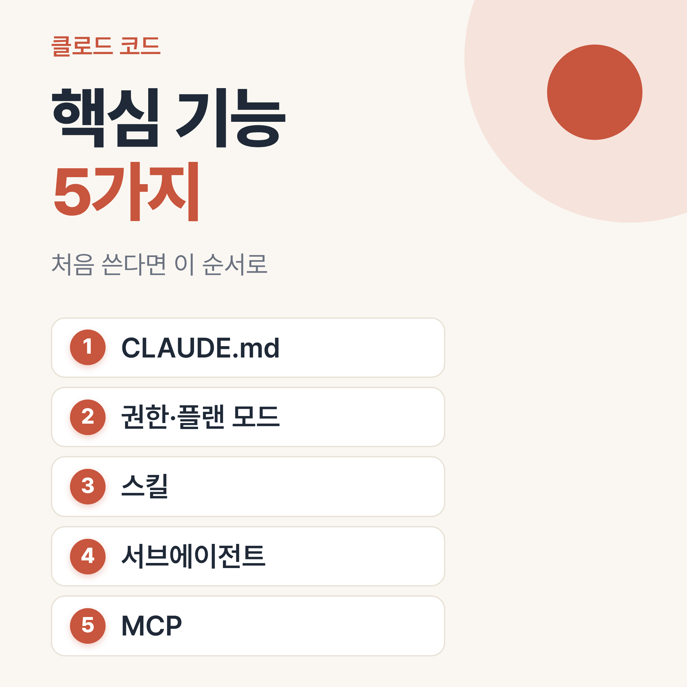
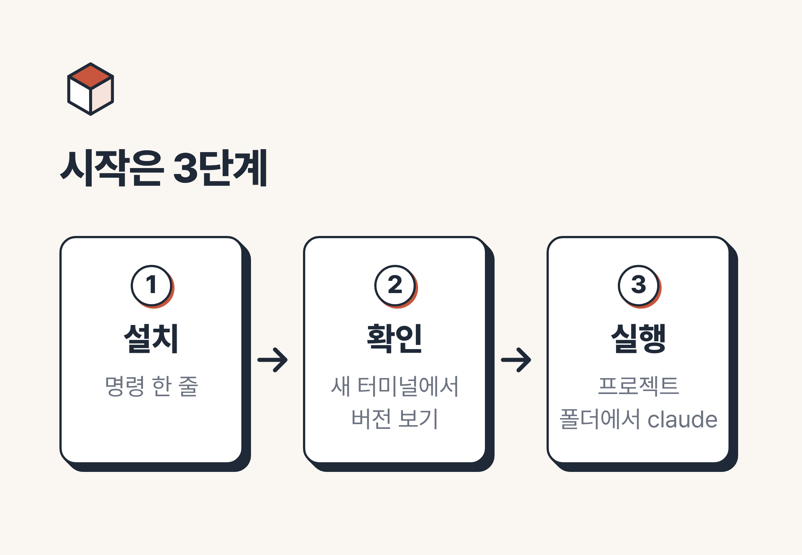
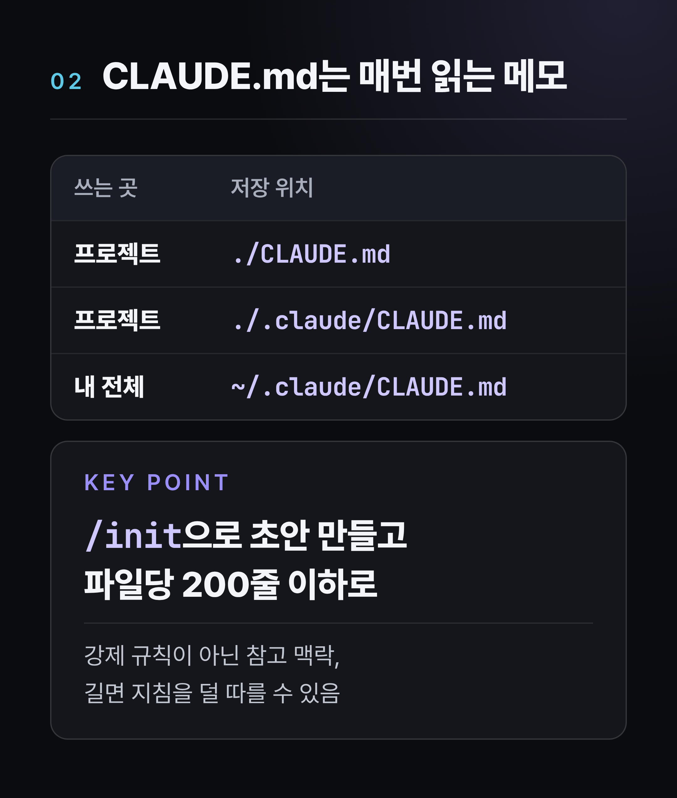
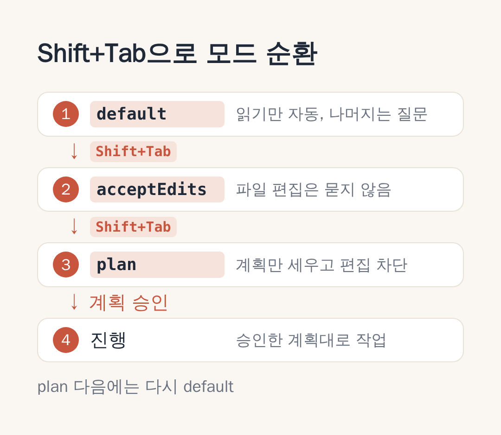
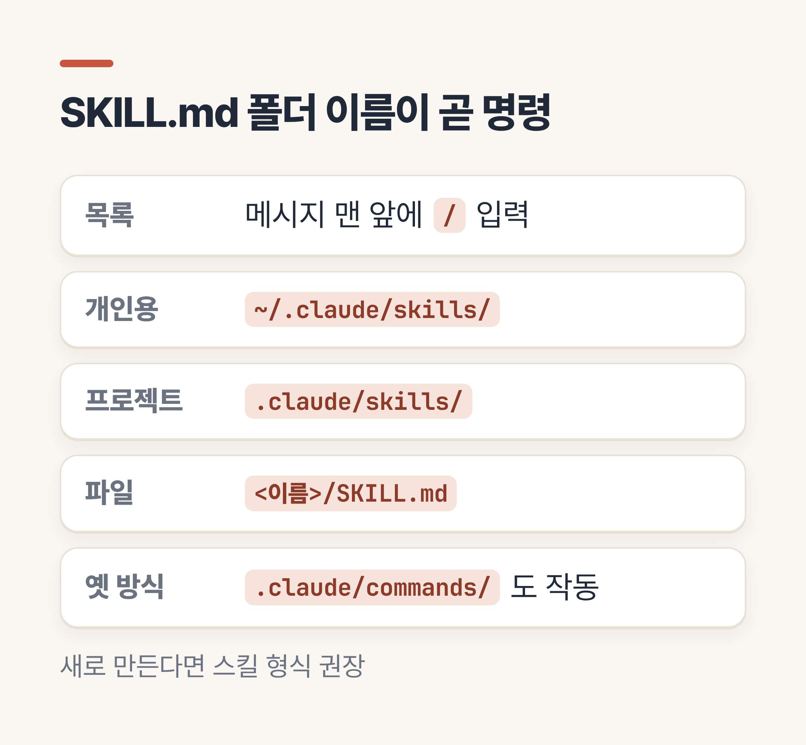
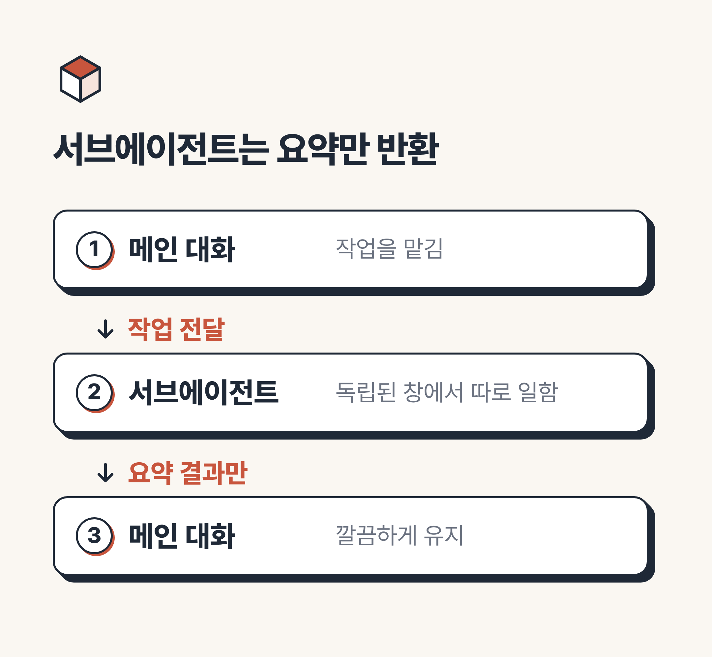
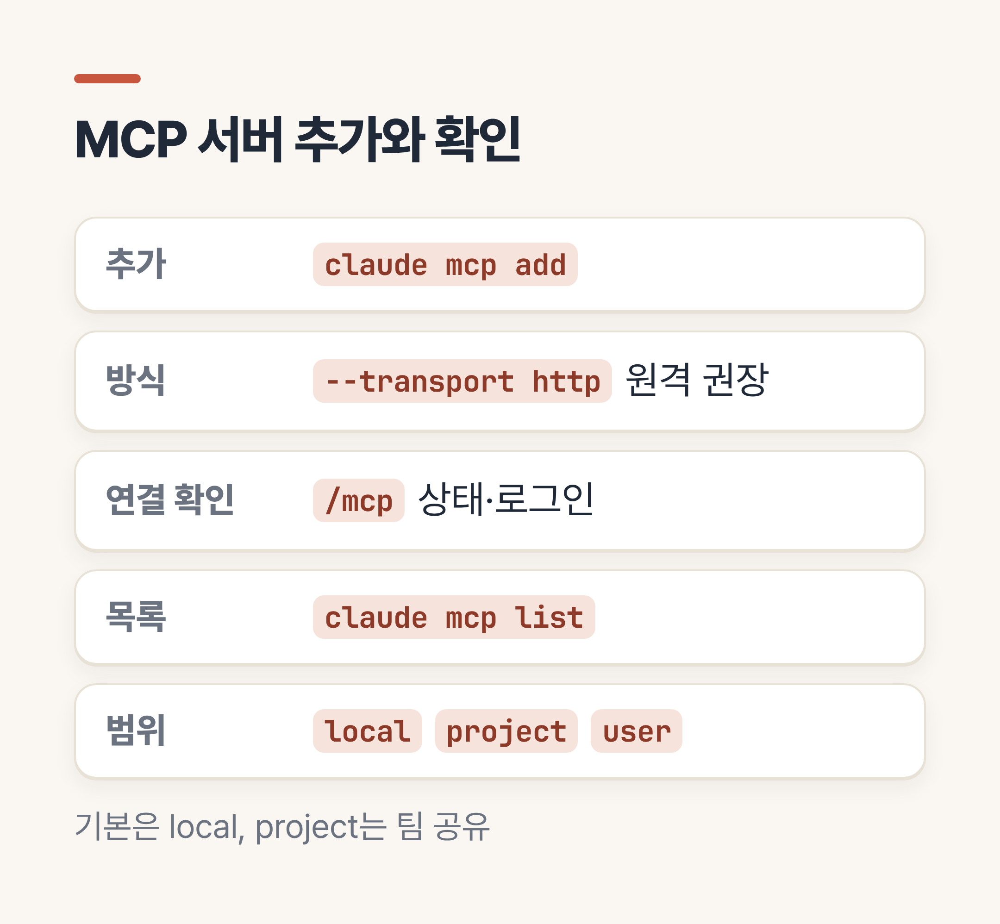
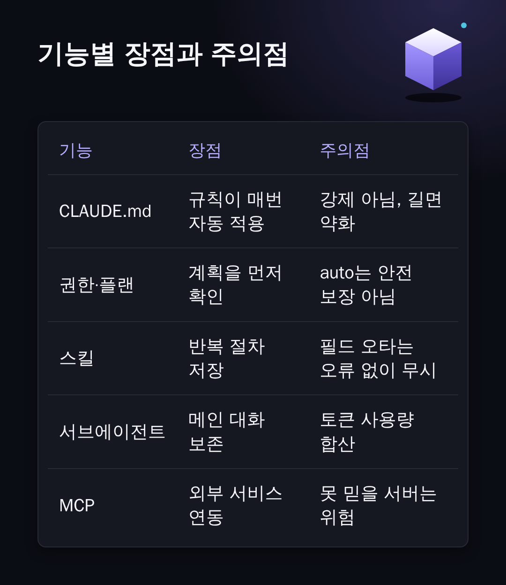
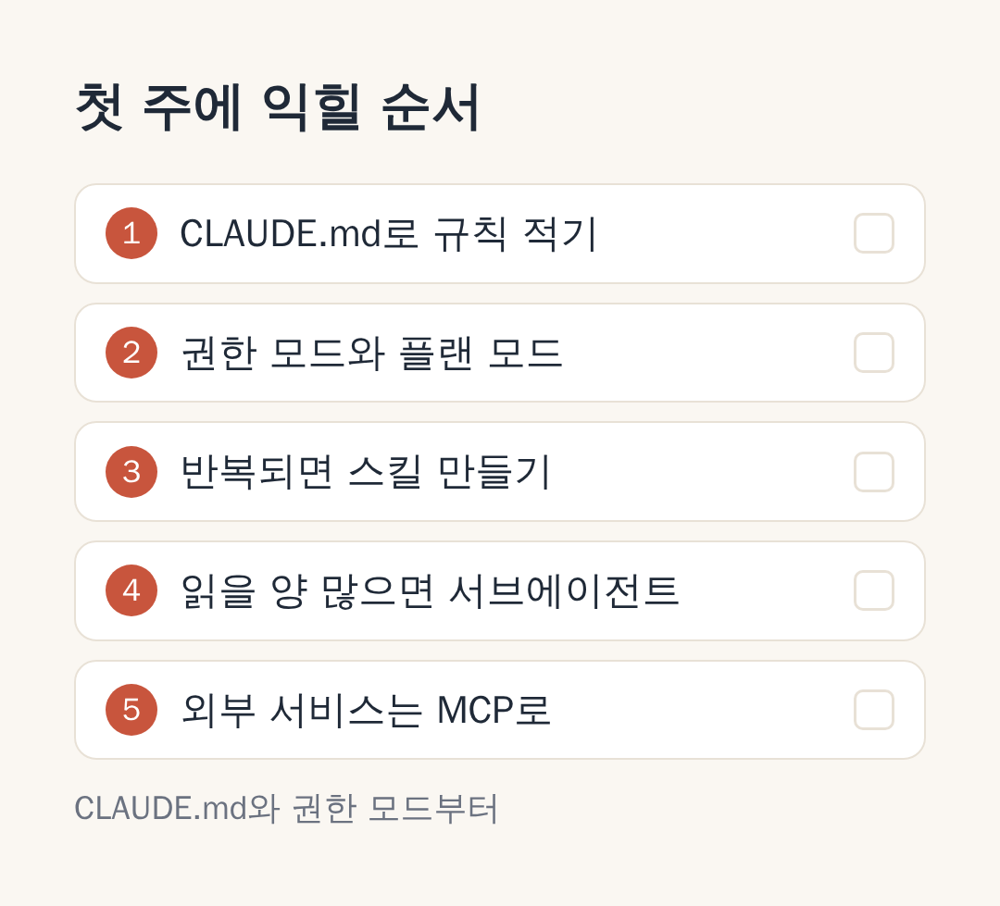

# 클로드 코드 핵심 기능 5가지, 처음 쓰는 분이 먼저 익힐 것

> 💡 **한 줄 요약:** 처음에는 CLAUDE.md, 권한 모드, 스킬, 서브에이전트, MCP 다섯 가지만 알면 충분하고, 공식 문서도 그중 CLAUDE.md부터 시작하라고 안내합니다.



안녕하세요, 여러분! 클로드 코드 핵심 기능이 무엇인지 알아보려니 명령어와 용어가 너무 많아 막막하셨죠? "기능이 이렇게 많은데 뭐부터 눌러야 하지?" 하는 고민, 처음 쓰는 분이라면 누구나 한 번쯤 하게 됩니다.

오늘은 Anthropic 공식 문서를 바탕으로, 첫 주에 실제로 마주치게 될 기능 다섯 가지를 골라 정리해 드리겠습니다. 이 글 하나만 끝까지 읽으시면 각 기능이 무엇이고, 언제 쓰며, 어디서 조심해야 하는지 큰 그림이 잡히실 거예요.

참고로 공식 문서가 "핵심 5가지"를 따로 지정해 둔 것은 아닙니다. 다섯 가지는 초보자가 먼저 마주치는 순서를 기준으로 **필자가 고른 것**이라는 점을 미리 밝혀 둡니다.

---

## 1. 시작하기 전에 - 클로드 코드를 쓰려면 무엇이 필요할까요?

클로드 코드는 터미널, VS Code, JetBrains, 데스크톱 앱, 웹에서 쓸 수 있는 AI 코딩 도구입니다. 프로젝트 폴더에서 `claude`를 실행하면 시작되고, 처음에는 로그인 과정을 거칩니다.

설치는 공식 문서가 권장하는 네이티브 설치 한 줄이면 됩니다.

```bash
# macOS, Linux, WSL
curl -fsSL https://claude.ai/install.sh | bash

# Windows PowerShell
irm https://claude.ai/install.ps1 | iex
```

설치가 끝나면 새 터미널을 열고 `claude --version`으로 확인해 보세요. (설치 직후 `claude`를 찾지 못한다면 PATH 설정을 먼저 의심해 보시면 됩니다.)



많은 분들이 가장 먼저 궁금해하시는 건 비용이죠. 조사일 기준 공식 요금 페이지를 보면 Free 플랜에는 클로드 코드가 포함되지 않고, 유료 플랜에 포함된다고 적혀 있습니다.

| 플랜 | 요금 표기 (USD, 세금 제외) | 클로드 코드 |
| :-- | :-- | :-- |
| Free | $0 | 포함되지 않음 |
| Pro | 월 $20 (연간 결제 시 월 $17) | 포함 |
| Max | 월 $100부터 | 포함 |

요금은 바뀔 수 있고, 한국 원화 금액이나 부가세 포함 여부는 확인하지 못했습니다. 결제 전에는 공식 요금 페이지에서 직접 확인해 주세요.

> 📌 **전문가 Tip:** 버전 번호는 빠르게 바뀌어서, 아래에서 설명하는 기능의 동작이 사용 중인 버전과 다를 수 있습니다. 최신 버전 기준으로 정리했으니 `claude --version`으로 먼저 확인해 보세요.

---

## 2. 클로드 코드 핵심 기능 5가지 - 무엇부터 익혀야 할까?

본격적으로 다섯 가지를 하나씩 짚어볼게요. 순서는 "먼저 익히면 좋은 것"부터입니다.

### 첫째, CLAUDE.md - 매번 같은 설명을 반복하고 계시진 않나요?

클로드 코드는 새 세션을 시작할 때마다 빈 상태에서 출발합니다. 어제 알려준 프로젝트 규칙을 오늘은 기억하지 못한다는 뜻이죠.

이때 쓰는 것이 **CLAUDE.md**입니다. 프로젝트 규칙을 적어 두면 클로드가 세션을 시작할 때 읽고 시작하는 메모 파일이에요.

* 프로젝트용은 `./CLAUDE.md` 또는 `./.claude/CLAUDE.md`, 내 모든 프로젝트용은 `~/.claude/CLAUDE.md`에 둡니다.
* `/init`을 실행하면 코드베이스를 분석해서 시작용 파일을 만들어 줍니다.
* 파일당 200줄 이하를 권장하며, 너무 길면 지침을 덜 따를 수 있습니다.
* 클로드가 스스로 메모하는 자동 메모리도 있고, `/memory`로 편집하거나 켜고 끌 수 있습니다.



하지만 중요한 건 CLAUDE.md가 **강제 규칙이 아니라 참고 맥락**이라는 점입니다. 반드시 막아야 하는 동작이 있다면 공식 문서는 훅 같은 다른 수단을 쓰라고 안내합니다.

제가 작업하는 저장소의 CLAUDE.md에는 서버 실행·테스트 명령, 폴더 구조, 지켜야 할 제품 원칙을 적어 두었습니다. 새 세션을 열 때마다 같은 설명을 처음부터 다시 적지 않아도 되는 구조예요. 다만 강제는 아니라서, 어겨서는 안 되는 규칙은 확인 수단을 따로 두는 편이 안전합니다.

### 둘째, 권한 모드와 플랜 모드 - 마음대로 고치면 어쩌죠?

비개발자분들이 가장 불안해하시는 부분이 아닐까 싶어요. "내 파일을 멋대로 바꾸면 어떡하지?" 하는 걱정이죠.

클로드 코드에는 얼마나 맡길지 정하는 **권한 모드**가 있습니다. 세션 중에 `Shift+Tab`을 누르면 모드가 순환하고, 기본 순환은 default, acceptEdits, plan 순서입니다.

* **Manual(default):** 읽기만 자동으로 하고, 나머지는 물어봅니다.
* **Edit automatically(acceptEdits):** 파일 편집은 묻지 않고 진행합니다.
* **Plan:** 파일을 읽고 계획만 세우며, 소스 편집은 막습니다.

초보자분께는 플랜 모드를 가장 먼저 권해 드려요. `Shift+Tab`이나 프롬프트 앞의 `/plan`으로 들어가 계획을 먼저 보고, 마음에 들면 승인하는 흐름입니다.



> 📌 **전문가 Tip:** 최신 버전에서는 터미널과 VS Code 세션의 기본 모드가 auto로 알려져 있습니다. auto는 분류기가 위험한 작업을 검토해 주지만, 공식 문서도 안전을 보장하는 것은 아니라고 밝힙니다. 처음에는 `Shift+Tab`으로 지금 어떤 모드인지 꼭 확인하세요. 잘못 바뀐 파일은 `/rewind`로 되돌릴 수 있습니다.

여러 파일을 건드리는 작업이라면 계획부터 받아 보시길 권합니다. 방향이 어긋난 것을 파일이 바뀌기 전에 발견하면 되돌릴 일 자체가 줄어들기 때문이에요.

### 셋째, 슬래시 명령과 스킬 - 같은 작업을 자꾸 시키고 계신가요?

메시지 맨 앞에 `/`를 입력하면 쓸 수 있는 명령과 스킬 목록이 나옵니다. `/clear`, `/compact`, `/resume`, `/usage`처럼 대화를 관리하는 기본 명령도 여기서 볼 수 있어요.

**스킬**은 자주 하는 절차를 `SKILL.md` 파일로 저장해 두는 기능입니다. 폴더 이름이 곧 `/이름` 명령이 되고, 내가 직접 부르거나 클로드가 설명을 보고 필요할 때 불러옵니다.

* 개인용은 `~/.claude/skills/<이름>/SKILL.md`, 프로젝트용은 `.claude/skills/<이름>/SKILL.md`에 둡니다.
* 옛 방식인 `.claude/commands/` 파일도 계속 작동하지만, 새로 만든다면 스킬 형식이 권장됩니다.
* 부작용이 있는 작업은 `disable-model-invocation: true`로 내가 부를 때만 실행되게 할 수 있습니다.

예전 블로그나 영상에서 `.claude/commands` 중심으로 설명한 것을 보셨다면, 지금은 스킬로 통합되는 흐름이라고 이해하시면 됩니다.



### 넷째, 서브에이전트 - 작업을 나눠 맡길 수는 없을까요?

서브에이전트는 메인 대화와 **따로 일하는 전문 보조 AI**입니다. 독립된 컨텍스트 창과 별도 지침, 제한된 도구를 가지고, 끝나면 결과 요약만 돌려줍니다.

덕분에 코드 탐색처럼 읽을 게 많은 일을 맡겨도 메인 대화가 지저분해지지 않아요. 만드는 방법은 두 가지입니다.

1. 클로드에게 "읽기 전용 코드 리뷰어 서브에이전트를 만들어줘"라고 요청합니다.
2. `.claude/agents/`(프로젝트) 또는 `~/.claude/agents/`(전체)에 마크다운 파일을 직접 씁니다. (필수 항목은 `name`과 `description`입니다.)

주의할 점이 있습니다. 최신 버전의 `/agents`는 예전처럼 만들기 마법사를 열지 않고, 요청하거나 파일을 직접 편집하라는 안내만 보여줍니다.



제 저장소의 `.claude/agents/`에는 기획, 서버 구현, 검증, 코드 리뷰 담당 서브에이전트가 있습니다. 이 글도 조사, 글쓰기, 이미지 제작, 조립 담당을 따로 두고 차례로 맡겨 만들었어요.

각 단계의 결과를 파일로 확인하며 넘어갈 수 있었고, 조사 담당에게는 웹 검색과 읽기·쓰기 도구만 주고 코드 실행 도구는 주지 않는 식으로 도구도 나눴습니다.

### 다섯째, MCP - 외부 서비스와 연결할 수 있을까요?

**MCP(Model Context Protocol)**는 AI 도구를 외부 데이터와 서비스에 잇는 개방형 표준입니다. 공식 문서의 예로는 Google Drive 문서 읽기, Jira 티켓 갱신, Slack 데이터 활용이 있어요.

원격 서버는 아래 형식으로 추가합니다.

```bash
claude mcp add --transport http <이름> <URL>
```

세션 안에서 `/mcp`를 입력하면 연결 상태를 확인하고 로그인할 수 있고, 터미널에서는 `claude mcp list`로 목록을 봅니다. 예전 예제에 나오는 `sse` 방식은 지원 중단 예정으로 표시되니, 원격 서버는 `http`를 쓰시는 편이 좋습니다.

> 📌 **전문가 Tip:** 신뢰하지 않는 MCP 서버는 프롬프트 인젝션, 즉 숨은 악성 지시에 노출될 위험이 있다고 공식 문서가 경고합니다. 출처를 확인한 서버만 연결하세요.



---

## 3. 다섯 가지를 한눈에 - 장단점은 무엇일까요?

지금까지 본 기능을 표로 모아 보겠습니다. 어디까지가 장점이고 어디부터 조심해야 하는지 비교해 보세요.

| 기능 | 장점 👍 | 단점·주의 👎 |
| :-- | :-- | :-- |
| CLAUDE.md | 매 세션 프로젝트 규칙이 자동 적용 | 강제가 아닌 맥락, 길면 준수율 하락 |
| 권한·플랜 모드 | 계획을 먼저 확인, 승인 피로 감소 | auto는 안전 보장이 아님 |
| 스킬 | 반복 절차 저장, 쓸 때만 본문 로드 | 철자가 틀린 필드는 오류 없이 무시됨 |
| 서브에이전트 | 메인 대화 보존, 도구 제한, 병렬 조사 | 토큰 사용량이 합산됨 |
| MCP | 외부 서비스와 직접 연동 | 신뢰할 수 없는 서버는 보안 위험 |



그렇다면 다섯 가지를 처음부터 전부 세팅해야 할까요? 그렇지 않습니다. 공식 문서는 기능을 많이 추가할수록 컨텍스트를 차지해 오히려 성능이 떨어질 수 있다고 경고해요.

그래서 추천하는 순서는 이렇습니다.

1. CLAUDE.md로 프로젝트 규칙을 적습니다.
2. 권한 모드를 확인하고 플랜 모드에 익숙해집니다.
3. 같은 실수나 같은 요청이 반복될 때 스킬을 만듭니다.
4. 읽을 양이 많은 작업은 서브에이전트에 맡깁니다.
5. 외부 서비스가 필요해질 때 MCP를 연결합니다.

훅은 항상 실행되어야 하는 자동 명령이라 설정 난도가 있어서, 위 다섯 가지에 익숙해진 다음 단계로 남겨 두었습니다.

---

## 4. 자주 묻는 질문 - 이런 건 어떨까요?

**Q. 무료로 쓸 수 있나요?**
조사일 기준 요금 페이지에는 Free 플랜에 클로드 코드가 포함되지 않는다고 나옵니다. Pro 이상의 유료 플랜이나 API 크레딧(Console 계정)이 필요해요.

**Q. 터미널을 한 번도 안 써봤는데 괜찮을까요?**
VS Code, 데스크톱 앱, 웹에서도 쓸 수 있어서 터미널이 부담스럽다면 그쪽부터 시작하셔도 됩니다. 다만 데스크톱 앱은 유료 구독이 필요합니다.

**Q. Windows에서도 되나요?**
됩니다. PowerShell과 CMD용 설치 명령이 따로 있고, Git for Windows 설치가 권장됩니다.

**Q. 스킬과 서브에이전트는 뭐가 다른가요?**
스킬은 내 대화에 불러와 쓰는 재사용 지침서이고, 서브에이전트는 따로 일하고 요약만 돌려주는 일꾼입니다.

### 공식 문서에서 더 확인하고 싶다면

* 개요: https://code.claude.com/docs/en/overview
* 퀵스타트(설치): https://code.claude.com/docs/en/quickstart
* CLAUDE.md와 메모리: https://code.claude.com/docs/en/memory
* 권한 모드: https://code.claude.com/docs/en/permission-modes
* 스킬: https://code.claude.com/docs/en/skills
* 서브에이전트: https://code.claude.com/docs/en/sub-agents
* MCP: https://code.claude.com/docs/en/mcp
* 요금: https://claude.com/pricing

---

## 5. 마무리하며

오늘은 클로드 코드 핵심 기능 다섯 가지, 곧 CLAUDE.md와 권한·플랜 모드, 스킬, 서브에이전트, MCP를 차례로 살펴보았습니다. 정리하면 "다 알 필요 없이 CLAUDE.md 하나와 권한 모드부터"라는 한 줄로 요약할 수 있어요.



처음엔 낯설어도 작은 설정 하나가 쌓이면 어느새 손에 익기 마련입니다. 오늘 정리한 내용이 첫걸음을 떼는 데 작은 도움이 되었기를 바랍니다.

여러분은 어떤 기능이 가장 궁금하셨나요? 써보시면서 막혔던 부분이나 궁금한 점은 댓글로 남겨주세요. 함께 풀어봐요. 감사합니다!

#클로드코드 #ClaudeCode #클로드코드사용법 #클로드코드기능 #CLAUDEmd #플랜모드 #서브에이전트 #MCP #AI코딩도구 #초보자가이드
