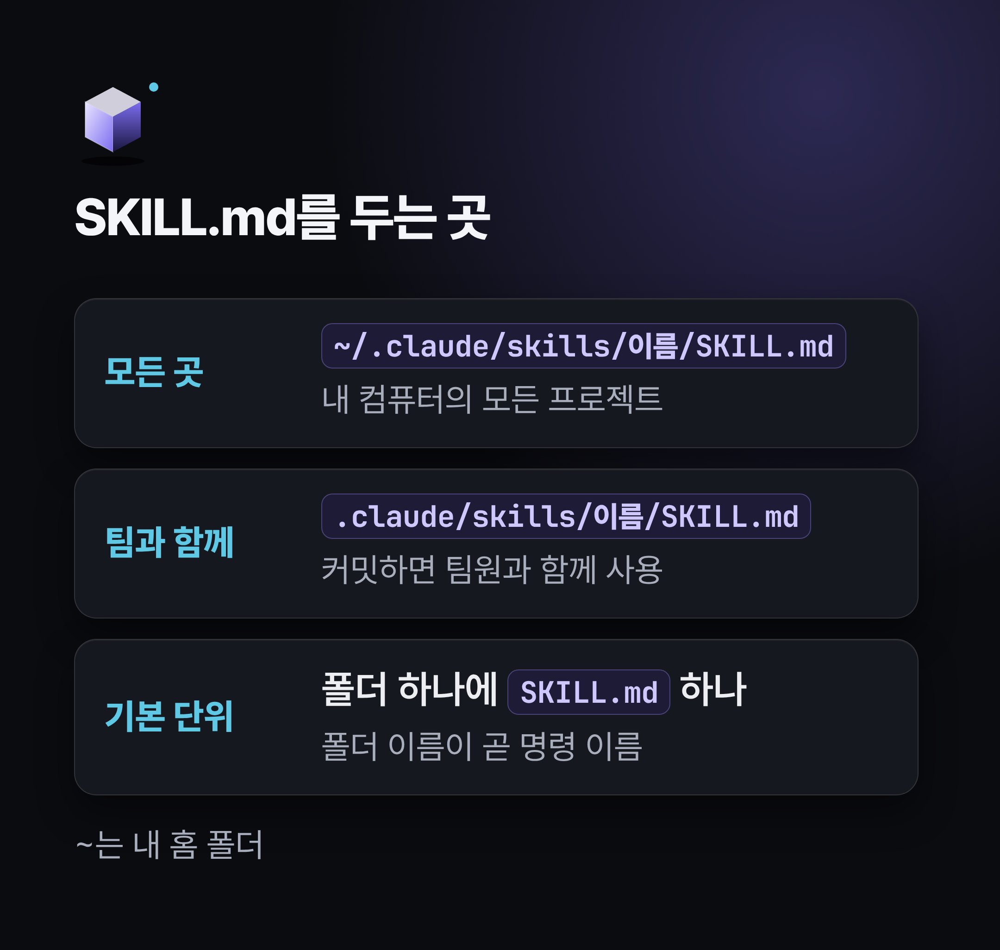
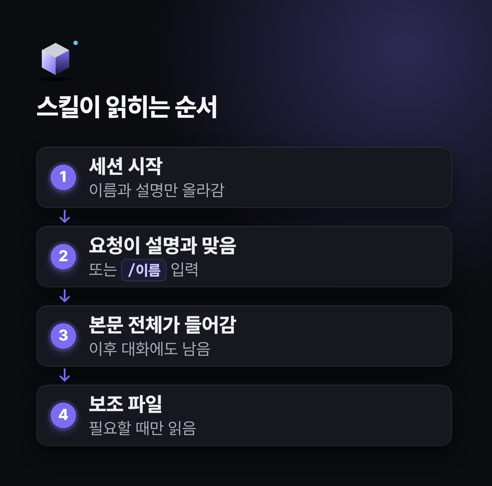
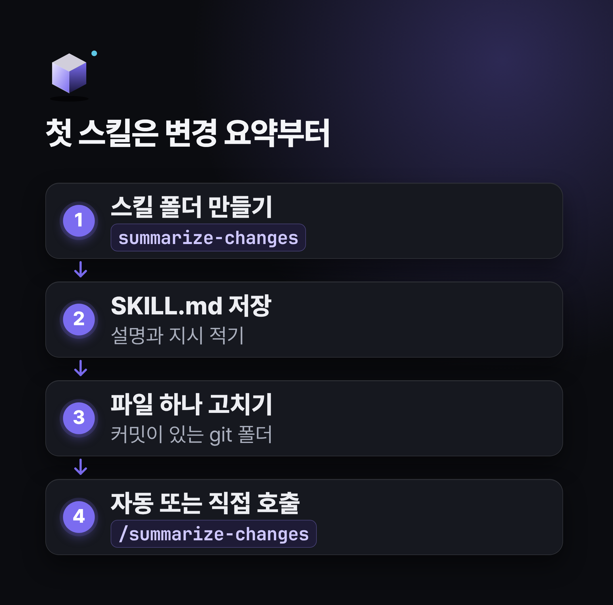
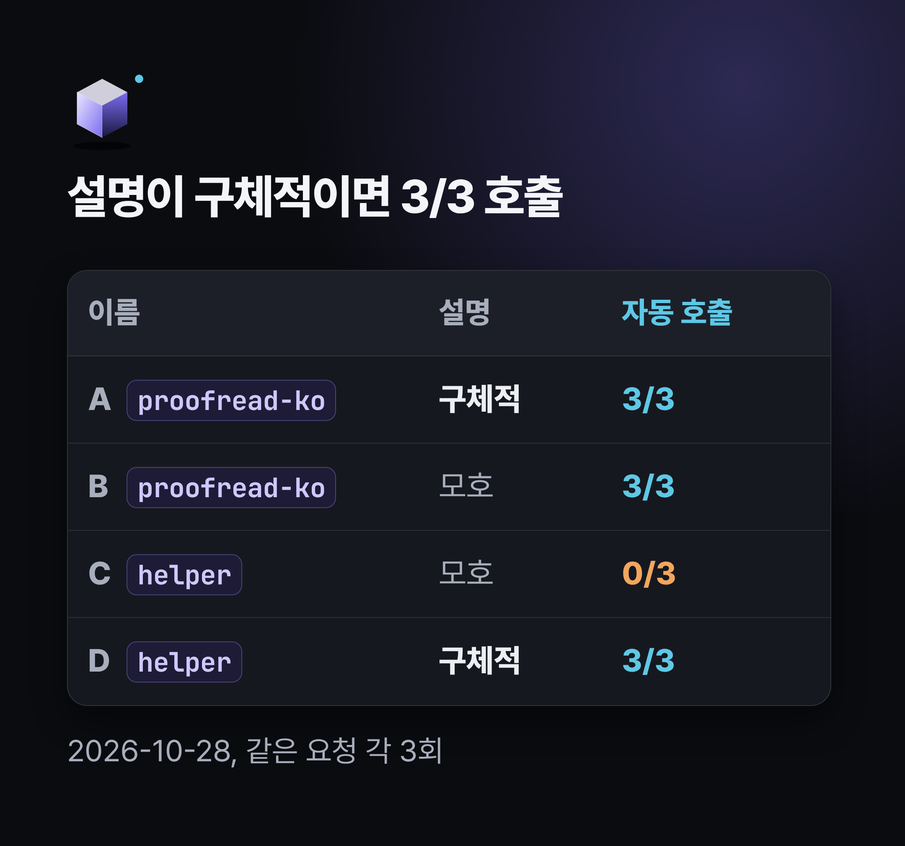
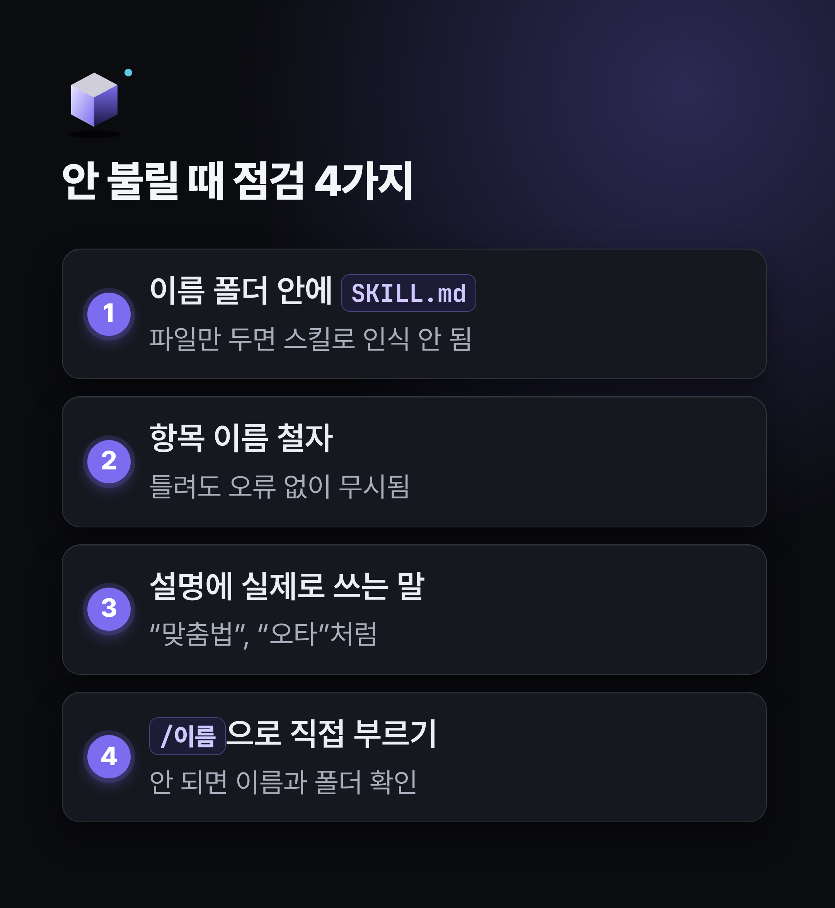
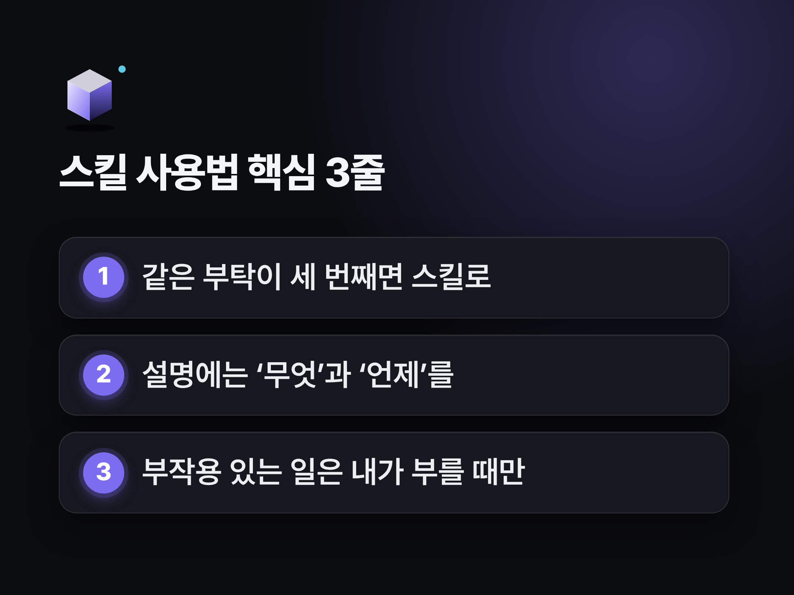

# 클로드 코드 스킬 사용법, 입문자도 따라 하는 반복 작업 3단계

> 💡 **한 줄 요약:** 클로드 코드 스킬 사용법의 핵심은 자주 하는 부탁을 `SKILL.md` 파일 하나에 적어 두는 것입니다. 폴더 이름이 곧 `/명령`이 되고, 설명을 또렷하게 적어 두면 Claude가 알아서 꺼내 쓰기도 해요.


"같은 부탁을 벌써 세 번째 붙여 넣고 있는데, 이걸 어디 저장해 둘 수는 없을까요?" 하고 한숨 쉬셨던 분들을 위해 정리했습니다.
스킬을 쓰면 그 부탁을 파일로 남겨 두고, `/이름` 한 번으로 다시 꺼내 쓸 수 있어요.
이 글을 따라오시면 스킬이 무엇인지, 어디에 두는지, 첫 스킬을 만들어 잘 불리게 다듬는 법까지 직접 해 보실 수 있습니다.

지난 글 '클로드 코드 훅 사용법'에서 꼭 지킬 규칙을 훅으로 바꿔 봤다면, 이번에는 자주 하는 부탁을 꺼내 쓰는 설명서로 만들어 봅니다.
첫 글 '클로드 코드 핵심 기능 5가지'에서 셋째로 짧게 소개했던 기능의 실습편이기도 합니다. 앞 글을 건너뛰셨어도 읽는 데는 지장이 없어요.

---

## 🛠️ 시작하기 전에 준비할 것들

* **준비물:** `claude`를 실행해 본 컴퓨터, 커밋이 한 번 이상 된 연습용 git 폴더
* **소요 시간:** 첫 스킬은 열 줄 남짓한 파일 하나면 됩니다. 시간은 불러 보고 고쳐 보는 데 더 들어요.
* **난이도:** 입문. 글자를 적어 파일로 저장할 수 있다면 충분합니다.

(git이 처음이라면 Claude에게 연습 폴더를 git으로 시작하고 첫 커밋까지 해 달라고 부탁하셔도 됩니다.)

처음 보는 말부터 풀어 드릴게요.

| 말 | 쉬운 뜻 |
| :-- | :-- |
| 스킬(skill) | 자주 쓰는 지침이나 절차를 적어 두고, 필요할 때 꺼내 쓰는 설명서 |
| `SKILL.md` | 스킬 내용을 적는 파일. 스킬 하나에 폴더 하나, 그 안에 이 파일 하나 |
| 프론트매터 | 파일 맨 위 `---`와 `---` 사이에 `항목: 값` 모양으로 적는 설정 |
| `description` | 스킬이 무엇을 하고 언제 쓰는지 적는 설명. Claude가 이걸 보고 스킬을 고름 |
| 컨텍스트 | Claude가 한 번에 보고 기억하는 대화와 파일의 분량 |
| 커밋(commit) | git에 지금 파일 상태를 한 번 저장해 둔 기록 |

이 글의 기능 설명은 **조사일(2026-10-28)에 열어 본 공식 문서**를 기준으로 썼습니다.
클로드 코드는 자주 바뀌니 `claude --version`으로 버전을 먼저 보시고, 글 아래 공식 문서도 함께 확인해 주세요.

글에 나오는 실험은 같은 날 Claude Code 2.1.312 버전으로 돌렸습니다.
앞 글들과 같은 할 일 목록 연습 프로젝트를 git으로 만들고, 스킬은 모두 그 프로젝트의 `.claude/skills/` 폴더에 두었어요. 개인 스킬이 섞이지 않도록 비어 있는 홈 폴더로 실행했고요.

질문 하나를 보내고 답을 받는 방식(`claude -p`)이라, Claude가 스스로 스킬을 골랐는지는 실행 기록에 남는 스킬 호출 흔적으로 판정했습니다.
자동 호출은 Claude가 그때그때 판단하는 일이고 경우마다 2~3번씩 돌린 결과라, 여러분 화면에서는 다르게 나올 수 있어요.

---

## 1. 스킬이 뭐예요? - CLAUDE.md·훅과 무엇이 다를까요?

공식 문서는 클로드 코드 스킬을 "Claude가 할 수 있는 일을 넓혀 주는 것"이라고 소개합니다.
`SKILL.md`에 지침을 적어 두면 Claude가 도구 상자에 넣어 두었다가, 대화와 관련 있을 때 꺼내 써요. 물론 내가 `/스킬이름`으로 직접 부를 수도 있습니다.

쓰임새는 크게 두 갈래입니다.

* **실행형:** 정해진 작업 절차. `/deploy`처럼 부르면 순서대로 일을 처리하는 스킬
* **참고형:** 작업하는 동안 계속 참고할 지식. 우리 팀의 API 작성 규칙 같은 것

첫 글에서는 스킬을 "자주 하는 절차를 저장하는 기능"으로만 소개했는데, 이렇게 참고 자료를 담아 두는 쓰임도 있다는 점을 덧붙여 둡니다.

그렇다면 언제 만들면 좋을까요?
공식 문서가 꼽는 신호는 같은 지침이나 체크리스트를 채팅에 계속 붙여 넣을 때, 그리고 CLAUDE.md의 일부가 '사실'이 아니라 '절차'로 길어졌을 때예요. 기능 비교 문서에는 "같은 절차를 세 번째 붙여 넣고 있다면 스킬로"라는 기준도 나옵니다.

비슷해 보이는 CLAUDE.md, 훅과는 이렇게 다릅니다.

| 구분 | CLAUDE.md | 스킬 | 훅 |
| :-- | :-- | :-- | :-- |
| 언제 작동하나 | 매 세션 시작 때 전부 읽힘 | 평소엔 이름·설명만, 쓸 때 본문이 올라감 | 정해진 순간마다 실행 |
| 누가 움직이나 | Claude가 읽고 판단 | Claude가 읽고 해석해 따름 | 클로드 코드 프로그램이 실행 |
| 잘 맞는 일 | "항상 이렇게 해" 같은 규칙 | 필요할 때 꺼내는 절차·참고 자료 | 예외 없이 지킬 규칙 |
| 직접 부르기 | 안 됨 | `/이름`으로 가능 | 부르지 않아도 알아서 실행 |


비유하자면 CLAUDE.md는 대화를 열 때마다 읽는 메모, 스킬은 필요할 때 펼치는 설명서, 훅은 예외 없이 돌아가는 장치예요.
공식 문서도 스킬은 Claude가 해석하는 지침이라 결과가 달라질 수 있으니, 꼭 지켜야 할 규칙은 훅으로 옮기라고 안내합니다.

서브에이전트와 헷갈리신다면 이렇게 구분하시면 쉬워요.
스킬은 지금 대화에 불러오는 설명서이고, 서브에이전트는 따로 일한 뒤 요약만 돌려주는 일꾼입니다.

예전 자료에서 `.claude/commands/` 폴더로 '커스텀 슬래시 명령'을 만드는 법을 보셨을 수도 있어요.
이 기능은 이미 스킬로 합쳐졌습니다. 공식 변경 이력 v2.1.3에 "슬래시 명령과 스킬을 합쳤다"는 기록이 있고, 지금 문서도 커스텀 명령이 스킬로 통합되었다고 적고 있어요.

첫 글에서는 이 변화를 "스킬로 통합되는 흐름"이라고 적었는데, 진행 중인 일이 아니라 이미 끝난 일이었습니다. 이 자리를 빌려 바로잡을게요.
기존 명령 파일은 지금도 그대로 작동하고, 같은 이름의 스킬이 있으면 스킬이 우선합니다. 새로 만드신다면 스킬 형식이 공식 권장이에요.

본격적으로 만들기 전에 장점과 주의점도 정리해 볼게요.

| 장점 | 주의점 |
| :-- | :-- |
| 같은 부탁을 한 번 적어 두고 계속 다시 씀 | 자동 호출은 Claude 판단이라 매번 보장되지 않음 |
| 쓸 때만 본문이 올라가 CLAUDE.md보다 가벼움 | 설명은 매 요청마다 컨텍스트 자리를 차지함 |
| 프로젝트 폴더에 두고 커밋하면 팀과 공유 | 항목 이름을 틀리게 적으면 오류 없이 무시됨 |
| 여러 AI 도구가 함께 쓰는 공개 표준(Agent Skills) 형식 | 남이 만든 스킬은 보안 위험이 있어 꼭 읽어 봐야 함 |

---

## 2. [1단계] 위치와 구조 - SKILL.md는 어디에, 어떤 모양으로 둘까요?

스킬은 **폴더 하나에 `SKILL.md` 하나**가 기본 단위입니다.
그럼 그 폴더는 어디에 두면 될까요? 위치에 따라 쓸 수 있는 범위가 달라져요.

* **`~/.claude/skills/<스킬이름>/SKILL.md`:** 내 컴퓨터의 모든 프로젝트에서 사용 (`~`는 내 홈 폴더)
* **`.claude/skills/<스킬이름>/SKILL.md`:** 이 프로젝트에서만 사용. 커밋하면 팀원과 함께 씀



이 밖에 플러그인이나 회사 관리 설정으로 배포되는 스킬도 있지만, 처음에는 위 두 곳만 알아도 넉넉해요.
따로 이름을 정하지 않으면 폴더 이름이 그대로 명령 이름이 된다는 점만 기억해 두세요.

필요하면 폴더 안에 보조 파일을 더 둘 수 있어요.

```text
my-skill/
├── SKILL.md      (필수: 개요와 안내)
├── reference.md  (상세 자료: 필요할 때 읽음)
├── examples.md   (사용 예시: 필요할 때 읽음)
└── scripts/
    └── helper.py (실행용 스크립트: 내용을 읽지 않고 실행)
```

보조 파일은 `SKILL.md` 안에서 링크로 언급해 둬야 Claude가 언제 읽을지 압니다.
공식 문서는 `SKILL.md`를 500줄 이하로 유지하고, 자세한 내용은 이렇게 따로 빼 두라고 조언해요.

`SKILL.md` 자체는 두 부분으로 나뉩니다.
위쪽 `---` 사이의 프론트매터에는 **언제 쓸지**를, 그 아래 본문에는 **무엇을 할지**를 적어요.

```markdown
---
name: my-skill
description: 무엇을 하는지, 그리고 언제 쓰는지 적는다.
---

여기에 Claude가 따를 지침을 적습니다.
```

처음 알아 둘 프론트매터 항목은 네 가지면 됩니다.

| 항목 | 하는 일 | 안 적으면 |
| :-- | :-- | :-- |
| `name` | `/` 메뉴에 보이는 명령 이름 | 폴더 이름을 씀 |
| `description` | 무엇을 하고 언제 쓰는지. Claude가 보고 고름 | 본문 첫 줄을 대신 씀 |
| `disable-model-invocation` | `true`면 내가 부를 때만 실행 | Claude도 부를 수 있음 |
| `argument-hint` | 입력할 때 보이는 인자 힌트 | 힌트 없음 |

> 📌 **전문가 Tip:** 클로드 코드에서는 이 항목이 모두 선택이고 `description`만 권장됩니다. 그런데 Claude 플랫폼(API) 문서는 `name`과 `description`을 필수로 보고, 이름은 64자 이내의 영어 소문자·숫자·하이픈만 허용해요. 다른 도구로 옮겨 쓸 일까지 생각하면 두 항목을 모두 적고, 이름은 `summarize-changes`처럼 영어 소문자와 하이픈으로 짓는 편이 안전합니다.

스킬이 가벼운 비결은 읽히는 순서에 있습니다.
세션이 시작되면 각 스킬의 이름과 설명만 올라가 있어요. 내가 `/이름`으로 부르거나 Claude가 설명을 보고 고르면, 그때 본문 전체가 대화에 들어갑니다.



한 번 들어온 본문은 이후 대화에도 남아 있습니다.
그래서 공식 문서는 "테스트를 실행하라"보다 "편집할 때마다 테스트를 실행하라"처럼 작업 내내 통하는 문장으로 쓰라고 권해요.

---

## 3. [2단계] 첫 스킬 만들기 - 자동 호출과 직접 호출, 둘 다 될까요?

첫 스킬로는 공식 문서가 맨 처음 소개하는 `summarize-changes`가 좋습니다.
아직 커밋하지 않은 변경 사항을 요약하고, 위험해 보이는 곳을 집어내 주는 스킬이에요.
원문은 영어라서 제가 한국어로 옮긴 버전으로 안내해 드릴게요.

아래 순서대로 차근차근 따라와 주세요.

1. **폴더 만들기:** 터미널에서 `mkdir -p ~/.claude/skills/summarize-changes`를 실행합니다. (macOS·Linux 기준이에요. 명령이 낯설다면 Claude에게 "아래 내용으로 `~/.claude/skills/summarize-changes/SKILL.md`를 만들어 줘"라고 부탁해도 됩니다.)
2. **`SKILL.md` 저장:** 그 폴더에 아래 내용을 저장합니다. (파일 이름은 `SKILL.md` 그대로 써 주세요.)
3. **파일 하나 고치기:** 커밋이 있는 git 폴더에서 아무 파일이나 한두 줄 고칩니다.
4. **불러 보기:** 그 폴더에서 `claude`를 실행한 뒤 "뭐 바꿨는지 알려 줘"라고 묻거나, `/summarize-changes`를 입력합니다.

```markdown
---
description: 아직 커밋하지 않은 변경 사항을 요약하고 위험해 보이는 부분을 짚어 준다. 사용자가 무엇이 바뀌었는지 묻거나, 커밋 메시지를 원하거나, 변경 내용 검토를 부탁할 때 사용한다.
---

## 현재 변경 사항

!`git diff HEAD`

## 지시

위 변경 사항을 두세 개의 글머리표로 요약한다. 그다음 오류 처리 누락, 하드코딩된 값, 고쳐야 할 테스트처럼 눈에 띄는 위험을 나열한다. 변경 사항이 비어 있으면 커밋하지 않은 변경이 없다고 말한다.
```

Windows에서 폴더를 만드는 명령은 공식 스킬 문서에 따로 나와 있지 않아요.
이럴 때도 Claude에게 파일 만들기를 맡기는 쪽이 편합니다.

`name`을 적지 않았으니 폴더 이름 `summarize-changes`가 그대로 명령 이름이 됩니다.
눈여겨볼 곳은 `` !`git diff HEAD` `` 한 줄이에요. 앞에 `!`를 붙인 명령은 Claude에게 내용을 보내기 전에 먼저 실행되고, 그 결과가 이 자리에 채워집니다.

`git diff HEAD`는 마지막 커밋 이후 무엇이 바뀌었는지 보여 주는 명령입니다.
덕분에 Claude는 바뀐 내용을 손에 쥔 채로 일을 시작해요. 다만 이런 `!` 명령 중 하나라도 실패하면 그 스킬 호출 전체가 멈춘다는 점은 알아 두세요.



정말 두 방식 모두로 불릴까요? 실제로 돌려 봤습니다.
연습 프로젝트의 `app.js`에 두 군데를 고쳐 두었어요. 빈 입력이면 할 일을 추가하지 않는 줄 하나, 그리고 어디에도 쓰지 않는 상수 `MAX_ITEMS = 20` 한 줄입니다.
(실험에서는 같은 파일을 개인 폴더 대신 프로젝트의 `.claude/skills/summarize-changes/`에 두었습니다.)

| | 자동 호출 | 직접 호출 |
| :-- | :-- | :-- |
| 입력 | "뭐 바꿨는지 알려 줘" | `/summarize-changes` |
| 스킬 사용 | Claude가 스스로 `summarize-changes`를 골라 부름 | 입력하자마자 스킬 내용이 들어감 |
| 답의 모양 | '바뀐 내용' 2개 + '눈에 띄는 위험' | '변경 요약' + '눈에 띄는 위험' |

두 경우 모두 스킬에 적은 순서, 곧 짧은 요약 다음에 위험 목록을 그대로 따랐어요.
위험 목록에는 쓰이지 않는 `MAX_ITEMS`, 사용자에게 알려 주는 안내가 없다는 점, 테스트 이야기가 들어 있었습니다.

가장 반가웠던 건 "공백만 입력하면 그대로 추가된다"는 지적이었어요.
빈 입력을 막으려고 넣은 줄이 공백만 있는 입력까지는 거르지 못한다는 뜻인데, 제가 보기에도 놓치기 쉬운 부분이었습니다.

`!` 명령도 따로 허용 설정을 하지 않았는데 실행되어, 변경 내용이 답에 반영됐어요.
공식 문서는 `git`의 읽기 전용 명령 같은 일부 명령을 어떤 모드에서도 승인 없이 실행되는 명령으로 분류하는데, 그래서 막힘없이 돌아간 것으로 보입니다.

> 📌 **전문가 Tip:** 클로드 코드를 켜 둔 채로 `SKILL.md`를 고치면 다시 시작하지 않아도 반영됩니다. 다만 세션을 시작할 때 없던 skills 폴더를 새로 만들었다면 `/reload-skills`를 한 번 실행해 주세요.

---

## 4. [3단계] 잘 불리게 다듬기 - description 한 줄이 왜 중요할까요?

기본이 끝났다면 이제 스킬이 원하는 때에 불리도록 손볼 차례입니다.
Claude는 내 요청을 각 스킬의 설명과 맞춰 보고 쓸 스킬을 골라요. 설명이 모호하거나 다른 스킬과 겹치면 엉뚱한 스킬을 쓰거나 아예 놓칠 수 있다고 공식 문서는 설명합니다.

### 4-1. 설명은 '무엇을 하는지 + 언제 쓰는지'로

공식 문서와 스킬 작성 모범 사례가 함께 꼽는 요령은 이렇습니다.

* **두 가지를 함께:** 무엇을 하는지와 언제 쓰는지를 한 설명에 담기
* **내가 실제로 쓰는 말:** "맞춤법", "띄어쓰기", "오타"처럼 요청할 때 쓸 단어 넣기
* **핵심은 앞쪽에:** 설명이 길면 뒤가 잘리니 가장 중요한 용도부터
* **담담한 3인칭:** 설명은 Claude의 지시문(시스템 프롬프트)에 들어가므로 "도와드릴게요" 같은 말투는 피하기

| 나쁜 예 | 좋은 예 |
| :-- | :-- |
| 문서 작업을 돕는다 | PDF에서 글과 표를 뽑고, 양식을 채우고, 문서를 합친다. PDF 파일을 다루거나 사용자가 PDF·양식·문서 추출을 말할 때 사용한다 |

표의 예시는 모범 사례 문서의 영어 예시를 한국어로 옮긴 것이에요.
길이는 조사일 기준으로 클로드 코드가 목록에 보여 줄 때 1,536자에서 자르고, 플랫폼 문서는 1,024자 이내를 요구합니다. 둘 다 여유가 있으니 길이보다 앞부분에 무엇을 두느냐에 신경 쓰시면 돼요.

설명 한 줄이 정말 그만큼 차이를 만들까요? 직접 시험해 봤습니다.
본문은 똑같고 이름과 설명만 다른 맞춤법 스킬 네 가지를 만들어, 각각 같은 요청을 세 번씩 보냈어요.
요청은 "이 문장 맞춤법 좀 봐 줘: 오늘 날씨가 너무 좋와서 산책을 갔는데 금새 비가 왔다."였습니다.

스킬 본문에는 답 첫 줄에 `[이름 스킬 사용]`이라는 표시 문구를 쓰고, 고친 문장과 "고치기 전 | 고친 뒤 | 이유" 표를 보여 달라는 지시를 넣었어요.

| 경우 | 이름 | 설명 | 자동 호출 |
| :-- | :-- | :-- | :-- |
| A | `proofread-ko` | 구체적: "한국어 문장의 맞춤법과 띄어쓰기를 고치고, 바뀐 곳을 표로 보여 준다. 사용자가 맞춤법 검사, 띄어쓰기 확인, 오타 교정, 문장 다듬기를 부탁할 때 사용한다." | 3/3 |
| B | `proofread-ko` | 모호: "문장 관련 작업을 한다." | 3/3 |
| C | `helper` | 모호: "도움을 준다." | 0/3 |
| D | `helper` | A와 같은 구체적 설명 | 3/3 |

3/3은 세 번 중 세 번 불렸다는 뜻입니다. C에서는 Claude가 스킬 없이 직접 맞춤법을 고쳤어요.



결과를 하나씩 풀어 볼게요.

* **B:** 설명이 모호해도 이름 `proofread-ko`가 단서가 되어 불렸어요. (제가 만든 스킬이 하나뿐인 환경이라 고를 대상이 적었다는 점은 감안해야 합니다.)
* **C:** 이름도 설명도 모호하니 세 번 모두 선택받지 못했습니다.
* **D:** 이름이 `helper`처럼 흐릿해도 설명이 구체적이면 매번 불렸어요.

Claude는 이름과 설명을 모두 판단 재료로 쓰지만, **설명이 구체적이면 이름과 상관없이** 불렸다는 게 이번 실험에서 얻은 결론입니다.
모범 사례 문서도 `helper`, `utils`, `tools` 같은 모호한 이름은 피하라고 해요. 다만 몇 번 돌려 본 결과일 뿐 통계적인 결론은 아니라는 점, 함께 밝혀 둡니다.

### 4-2. 내가 부를 때만 실행하기

커밋, 배포, 메시지 보내기처럼 실행하면 흔적이 남거나 시점을 내가 정해야 하는 일은 Claude가 알아서 부르면 곤란하죠.
이럴 때 프론트매터에 `disable-model-invocation: true` 한 줄을 넣습니다.
Claude가 그래도 부르려 하면 클로드 코드가 막고, Claude는 내게 직접 `/이름`을 실행해 보라고 제안하게 돼요.

이름이 비슷한 `user-invocable: false`와는 방향이 반대입니다.

| 설정 | 내가 `/이름`으로 | Claude가 알아서 | 설명이 미리 올라가나 |
| :-- | :-- | :-- | :-- |
| (기본) | 가능 | 가능 | 항상 |
| `disable-model-invocation: true` | 가능 | 불가 | 부르기 전엔 안 올라감 |
| `user-invocable: false` | 불가 (메뉴에서도 숨김) | 가능 | 항상 |

`user-invocable: false`는 `/` 메뉴에서 감출 뿐, Claude는 여전히 그 스킬을 쓸 수 있어요.
Claude의 호출까지 막고 싶다면 `disable-model-invocation: true` 쪽을 쓰셔야 합니다.

두 방식은 장단점이 뚜렷하게 갈립니다.

| 방식 | 장점 | 단점 |
| :-- | :-- | :-- |
| 자동 호출 허용(기본) | 이름을 몰라도 상황에 맞게 꺼내 씀 | Claude 판단이라 매번 보장되지 않고, 설명이 늘 컨텍스트를 차지 |
| 내가 부를 때만 | 원하는 순간에만 실행, 부르기 전엔 컨텍스트를 쓰지 않음 | 이름을 기억해 두고 직접 입력해야 함 |

### 4-3. 입력한 말 받아 쓰기 - `$ARGUMENTS`

스킬 이름 뒤에 덧붙인 말은 본문의 `$ARGUMENTS` 자리에 들어갑니다.
같은 스킬을 주제만 바꿔 가며 쓸 수 있어 쓸모가 많아요. 블로그 제목 후보를 뽑는 스킬로 예를 들어 볼게요.

경로는 프로젝트의 `.claude/skills/blog-titles/SKILL.md`입니다.

```markdown
---
name: blog-titles
description: 주어진 주제로 블로그 글 제목 후보 5개를 만든다. 사용자가 블로그 제목을 지어 달라고 할 때 사용한다.
disable-model-invocation: true
argument-hint: [주제]
---

주제: $ARGUMENTS

위 주제로 블로그 글 제목 후보 5개를 만든다.
- 제목마다 30자 안팎으로 쓴다.
- 주제 핵심어를 제목 앞쪽에 둔다.
- 과장된 표현은 쓰지 않는다.
번호 목록으로만 답한다.
```

`/blog-titles` 뒤에 주제를 붙여 부르면, 그 말이 통째로 `$ARGUMENTS` 자리에 들어가요.
낱말을 하나씩 따로 받고 싶다면 `$0`, `$1`처럼 0부터 세는 번호를 씁니다. 여러 단어를 한 덩어리로 넘길 때는 큰따옴표로 묶으면 되고요.
본문에 이런 자리표시자가 아예 없으면 클로드 코드가 끝에 `ARGUMENTS: <입력한 말>`을 붙여 전달합니다.

이 스킬로도 확인해 봤어요.
결과를 눈으로 가려내려고, 실험할 때는 본문 첫 줄에 `[blog-titles 스킬 사용] 주제: $ARGUMENTS`를 쓰라는 지시를 넣어 두었습니다.

* **알아서 불릴까:** "클로드 코드 스킬 주제로 블로그 제목 5개 지어 줘"를 2회 보냈더니, 2회 모두 스킬 호출도 표시 문구도 없었어요. Claude가 스킬 없이 직접 제목을 지었습니다.
* **직접 부르면:** `/blog-titles 클로드 코드 스킬`을 입력하자 첫 줄에 `[blog-titles 스킬 사용] 주제: 클로드 코드 스킬`이 찍히고, 이어서 제목 다섯 개가 번호 목록으로 나왔어요.

`disable-model-invocation`이 막는 건 'Claude가 이 스킬을 꺼내 쓰는 것'이지, 비슷한 부탁에 답하는 것 자체가 아니라는 점이 잘 드러난 결과였습니다.

---

## 5. 안 될 때는 어떻게 하나요? - 흔한 실수와 보안 주의

"분명히 만들었는데 왜 안 불리죠?" 싶은 순간이 옵니다.
아래 1)과 2)는 제가 일부러 틀리게 만들어 결과를 확인한 경우예요.

**1) 항목 이름 철자가 하나 틀렸어요**

3단계의 `blog-titles`에서 `disable-model-invocation`을 `disable-model-invokation`으로, c 한 글자만 k로 바꿔 봤습니다.
같은 자동 요청을 2회 보냈더니 2회 모두 Claude가 `blog-titles`를 스스로 불러 썼어요. 오류나 경고는 한 줄도 없었습니다.

클로드 코드가 모르는 항목 이름을 조용히 넘어가기 때문이에요.
항목 이름은 하이픈까지 공식 문서와 똑같이 적어야 합니다. 프론트매터 문법(YAML)이 깨지면 항목 없이 본문만 읽혀서, `/이름`으로 부르면 작동해도 Claude가 설명을 보고 고르지는 못해요.
깨진 프론트매터는 `claude plugin validate .claude/skills`(v2.1.233 이상)로 찾을 수 있습니다.

**2) 폴더 없이 파일만 뒀어요**

이번에는 `.claude/skills/blog-titles.md`처럼 폴더를 만들지 않고 파일 하나만 둔 채 같은 명령을 입력했습니다.
Claude는 "참고로 `/blog-titles` 명령은 이 세션에 설치되어 있지 않아요"라며 대신 직접 처리하는 쪽으로 넘어갔어요. 스킬로 아예 인식되지 않은 거죠.
`.claude/skills/blog-titles/SKILL.md`처럼 **이름 폴더 안에** `SKILL.md`가 있어야 합니다.

**3) 목록에 있는지부터 보세요**

만든 스킬이 보이는지는 이렇게 확인합니다.

* **`/` 입력:** 명령 메뉴에 스킬 이름이 나오는지 봅니다.
* **`/skills`:** 프로젝트·개인·플러그인 스킬 목록이 나와요. "user-only" 표시가 붙어 있다면 `disable-model-invocation: true`가 켜진 스킬입니다.
* **말로 묻기:** "지금 사용할 수 있는 스킬 목록 알려 줘"라고 물어도 됩니다.

세 번째 방법으로 실험 폴더에서 물어보니, 목록 맨 위쪽에 제가 만든 `summarize-changes`가 설명과 함께 나왔어요.
`code-review`, `simplify`처럼 클로드 코드에 원래 들어 있는 스킬도 함께 보였습니다. 목록 길이는 설치된 플러그인 등 환경에 따라 달라지니, 개수 자체는 중요하지 않습니다.

목록에는 보이는데 자동으로 불리지 않는다면 아래 순서로 좁혀 보세요.

1. 설명에 내가 실제로 쓰는 말이 들어 있는지 봅니다.
2. 요청 문장을 설명에 더 가깝게 바꿔 봅니다.
3. `/이름`으로 직접 불러 봅니다. (이것도 안 되면 이름과 폴더 구조를 다시 살펴요.)
4. 반대로 너무 자주 불린다면 설명을 더 좁히거나 `disable-model-invocation: true`를 켭니다.

처음엔 잘 따르다가 나중에 지시를 놓친다면, 꼭 지켜야 하는 부분은 지난 글에서 다룬 훅으로 옮기라는 것이 공식 문서의 안내예요.



> 📌 **전문가 Tip:** 설명에 `맞춤법 검사: 띄어쓰기`처럼 콜론과 공백(`: `)이 들어가면 YAML 문법이 깨지기 쉽습니다. 이런 값은 큰따옴표로 감싸 두세요. 이상하다 싶을 땐 `claude --debug`로 실행해 읽는 과정의 오류를 확인할 수 있어요.

마지막으로 보안 이야기입니다.
Claude 플랫폼 문서는 남이 만든 스킬을 **소프트웨어를 설치하듯** 신중하게 다루라고 강조해요.

* **믿을 수 있는 출처만:** 직접 만들었거나 믿을 수 있는 곳에서 받은 스킬만 씁니다. 악성 스킬은 설명과 다른 방식으로 도구를 쓰거나 코드를 실행하게 만들 수 있어요.
* **묶인 파일 전부 읽기:** `SKILL.md`뿐 아니라 스크립트 등 함께 든 파일을 모두 열어 봅니다. 외부 주소에서 데이터를 가져오는 스킬은 특히 조심하세요.
* **`allowed-tools` 확인:** 이 항목은 스킬을 부른 그 차례(다음 메시지를 보내기 전까지) 동안 적힌 도구를 승인 없이 쓰게 해 줍니다. 저장소에 든 스킬이라면 그 폴더를 믿는다고 확인했는지와 상관없이 적용되니, 남의 저장소에서 클로드 코드를 켜기 전에 `.claude/skills/` 안을 먼저 읽어 보세요.

`allowed-tools`는 이름과 달리 도구를 제한하는 기능이 아니라는 점도 헷갈리기 쉬워요.
특정 도구를 못 쓰게 막으려면 `disallowed-tools`를 씁니다.

---

## 6. 자주 묻는 질문 - 이런 점이 궁금하셨죠?

**Q. 코딩을 전혀 몰라도 스킬을 만들 수 있나요?**
네. 스킬의 기본은 글로 적은 마크다운 파일 하나이고, 스크립트는 필요할 때만 더하는 선택 사항이에요.
플랫폼 문서에 따르면 Claude에게 스킬을 만들어 달라고 해도 형식에 맞는 `SKILL.md`를 써 줍니다. 받은 내용은 한 번 읽어 보고 저장하세요.

**Q. 예전에 `.claude/commands/`에 만든 명령은 어떻게 되나요?**
지금도 그대로 작동합니다. 같은 이름으로 스킬을 만들면 스킬 쪽이 이겨요.
스킬 형식은 보조 파일 폴더, 호출을 조절하는 항목, 관련 있을 때 알아서 불리는 기능까지 더해 주니 새로 만들 때는 스킬을 고르시면 됩니다.

**Q. 스킬을 많이 만들면 느려지지 않나요?**
설명은 매 요청마다 컨텍스트에 올라가니 끝없이 늘리는 건 좋지 않아요.
조사일 기준으로 스킬 목록 전체에는 컨텍스트 창의 1%라는 예산이 있고, 넘치면 덜 쓰는 스킬부터 설명이 빠집니다.

설명이 빠진 스킬도 `/이름`으로는 부를 수 있지만, Claude가 스스로 고를 가능성은 낮아져요.
`/skill-doctor`(v2.1.252 이상)로 스킬별로 차지하는 분량과 사용 빈도를 확인해 안 쓰는 스킬을 정리할 수 있습니다.

**Q. claude.ai에서 만든 스킬도 클로드 코드에서 보이나요?**
클로드 코드 문서에 따르면 claude.ai 계정으로 로그인한 터미널 세션은 계정의 스킬을 `~/.claude/skills/synced/`로 내려받습니다. 내려받기만 하고 올리지는 않아요.
원치 않으면 사용자 설정에 `"syncClaudeAiSkills": false`를 넣으면 됩니다. 다만 Claude 플랫폼 개요 문서에는 서로 동기화되지 않는다는 설명도 있어서, 실제로는 `/skills`에서 직접 확인해 보시는 편이 확실해요.

**Q. 스킬 이름을 한글로 지어도 되나요?**
클로드 코드 문서가 거부한다고 밝힌 문자 목록에 한글은 없습니다.
하지만 한글 이름이 메뉴에서 제대로 동작하는지는 문서에 나와 있지 않고, 저도 확인하지 못했어요. 다른 도구로 옮겨 쓸 가능성까지 생각하면 영어 소문자와 하이픈 이름이 무난합니다.

### 공식 문서에서 더 확인하고 싶다면

* 스킬 문서(만들기, 항목, 인자): https://code.claude.com/docs/en/skills
* CLAUDE.md·스킬·훅·서브에이전트 비교: https://code.claude.com/docs/en/features-overview
* 설정이 안 먹을 때 점검하기: https://code.claude.com/docs/en/debug-your-config
* 스킬 작성 모범 사례(Claude 플랫폼): https://platform.claude.com/docs/en/agents-and-tools/agent-skills/best-practices
* Agent Skills 개요와 보안 주의(Claude 플랫폼): https://platform.claude.com/docs/en/agents-and-tools/agent-skills/overview

---

## 7. 마무리

오늘은 클로드 코드 스킬 사용법을 스킬이 무엇인지부터 위치와 구조, 첫 스킬 만들기, 설명과 호출 방식 다듬기, 안 될 때의 점검과 보안까지 차례로 살펴보았습니다.
세 줄로 줄이면 "같은 부탁이 세 번째면 스킬로, 설명에는 '무엇'과 '언제'를, 부작용 있는 일은 내가 부를 때만"이에요.



CLAUDE.md로 부탁하는 법, 훅으로 규칙을 지키게 하는 법에 이어 이제 자주 하는 일을 꺼내 쓰는 법까지 갖추셨습니다.
처음부터 스킬을 여러 개 만들 필요는 없습니다. 오늘 만든 변경 요약 스킬 하나만 곁에 두어도 커밋 전 확인이 한결 가벼워질 수 있어요.
이 글이 여러분만의 첫 스킬을 만드는 데 작은 디딤돌이 되었으면 합니다.

여러분은 어떤 부탁을 가장 먼저 스킬로 만들어 보고 싶으신가요?
따라 하시다 막힌 곳이 있다면 댓글로 남겨 주세요. 끝까지 읽어 주셔서 고맙습니다!

#클로드코드스킬 #클로드코드 #ClaudeCode #ClaudeCodeSkills #SKILLmd #클로드코드사용법 #클로드코드입문 #슬래시명령 #AI코딩도구
