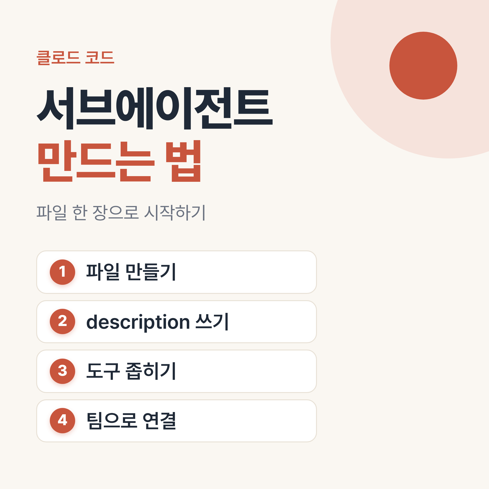
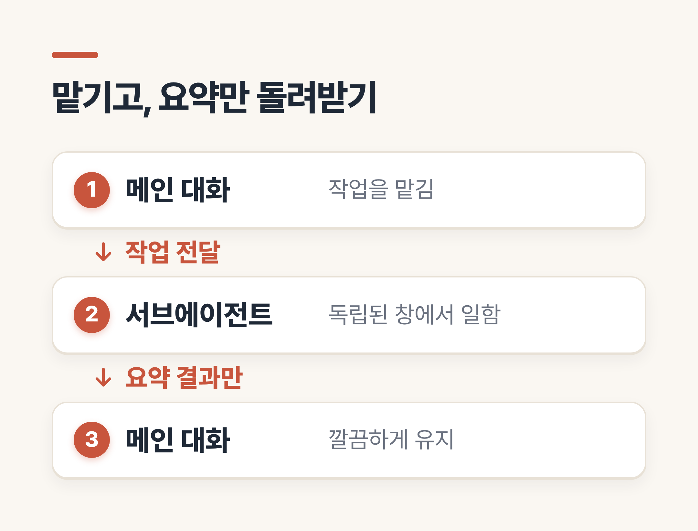
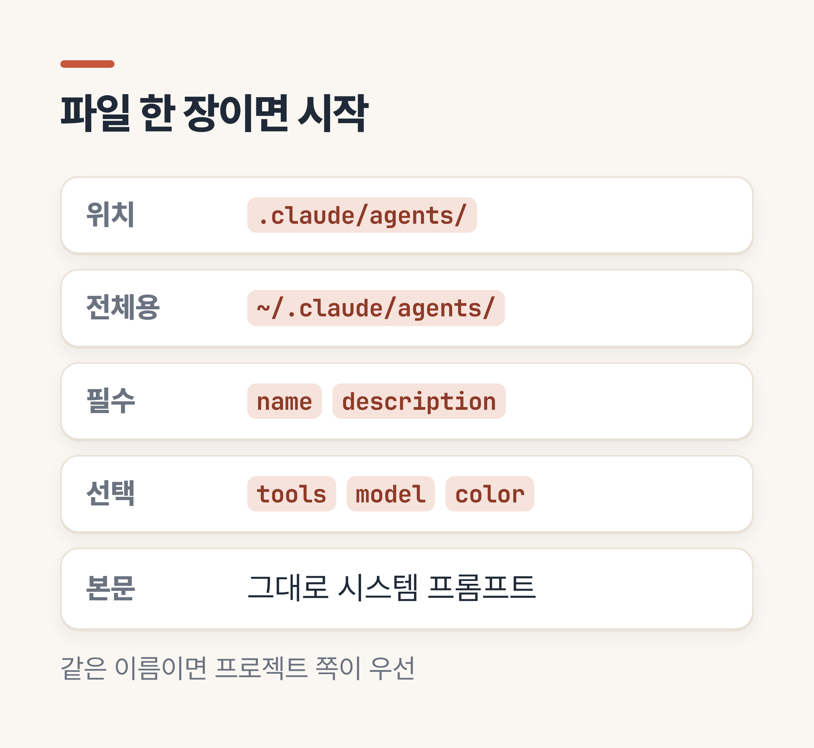
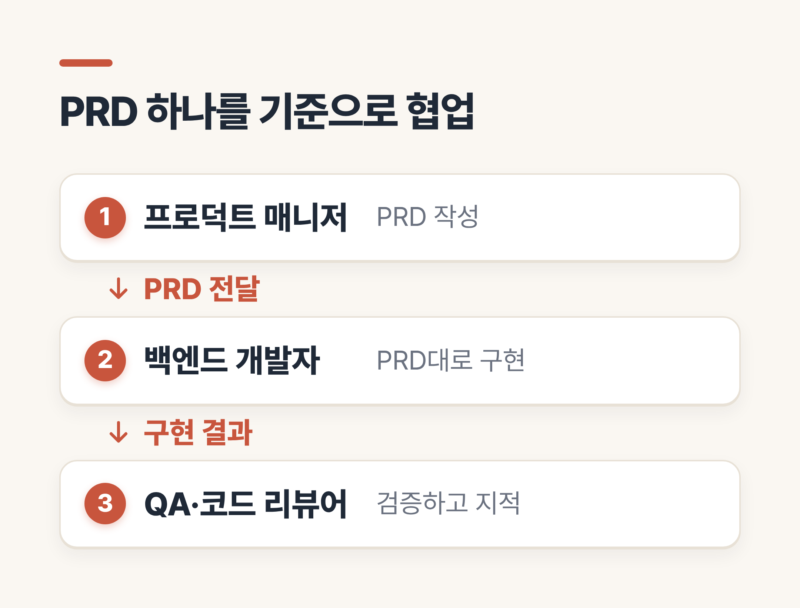
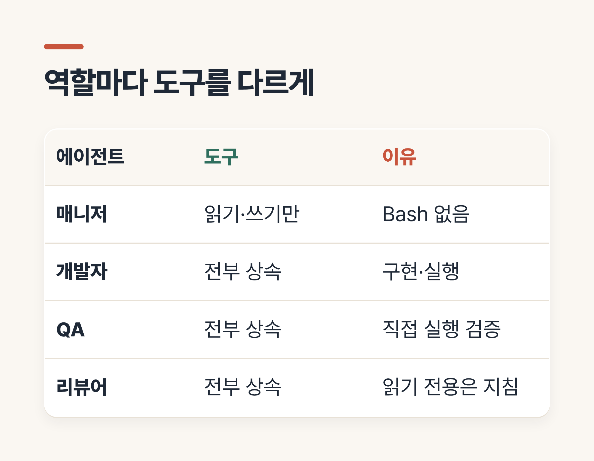
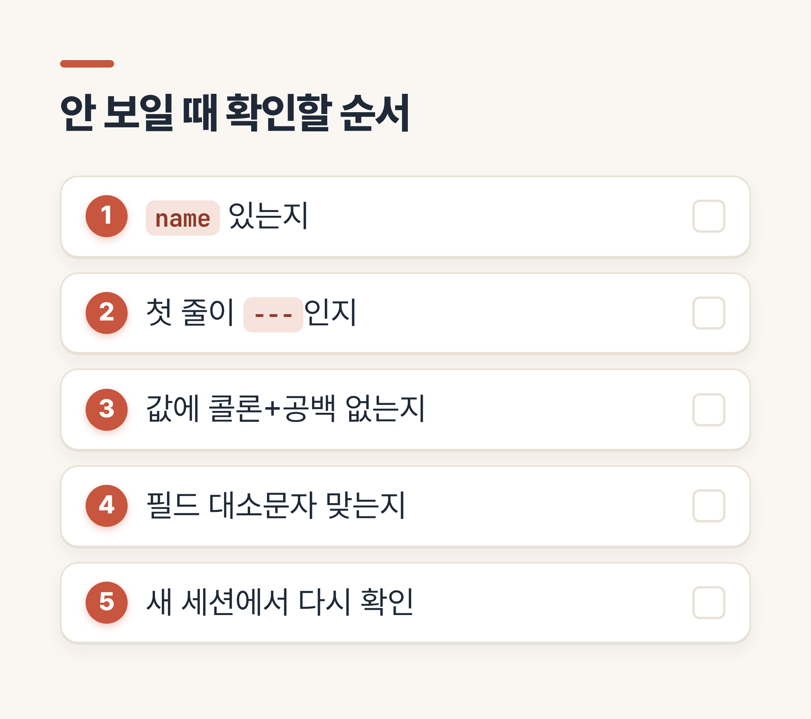

# 클로드 코드 서브에이전트 만드는 법, PM·개발·QA 팀 꾸리기

> 💡 **한 줄 요약:** 클로드 코드 서브에이전트는 `.claude/agents/`에 마크다운 파일 한 장만 넣으면 만들어지고, 역할별로 파일을 나누면 기획부터 검증까지 한 대화에서 순서대로 맡길 수 있습니다.



안녕하세요, 여러분! 클로드 코드 서브에이전트가 좋다는 말은 많이 듣는데, 막상 직접 만들려니 어디서부터 손대야 할지 막막하셨죠?
"파일은 어디에 두고, 뭘 적어야 하지?" 하는 고민을 가장 많이 하십니다.

오늘은 공식 문서를 바탕으로 서브에이전트를 만드는 방법을 정리하고, 제가 이 저장소에서 기획·개발·QA·리뷰 에이전트 네 명을 실제로 꾸려 본 과정을 함께 보여 드리겠습니다.
끝까지 읽으시면 파일 한 장을 만드는 것부터 역할을 나누는 기준까지 스스로 해보실 수 있을 거예요.

---

## 1. 서브에이전트가 뭔가요? - 왜 따로 만들까요?

서브에이전트는 **독립된 대화 창과 자기만의 지침, 제한된 도구**를 가진 보조 AI입니다.
메인 대화가 일을 맡기면 혼자 일하고, 끝나면 요약 결과만 돌려줍니다.

그래서 긴 조사나 대량의 파일 읽기를 맡겨도 메인 대화가 지저분해지지 않아요.
한 사람이 모든 일을 하는 대신 부서를 나누는 것과 비슷합니다.



> 📌 **전문가 Tip:** 서브에이전트는 메인 대화의 기록을 보지 못합니다. 일을 맡길 때 필요한 배경을 메시지에 직접 적어 주셔야 해요. 새 컨텍스트 창으로 시작해서 대화 기록, 읽은 파일, 호출한 스킬을 모르기 때문입니다(공식 문서 기준, fork는 예외).

---

## 2. 파일 한 장으로 만들기 - 무엇을 적어야 할까요?

만드는 방법은 두 가지입니다.
클로드에게 "읽기 전용 코드 리뷰어 서브에이전트를 만들어줘"라고 요청하거나, 파일을 직접 쓰는 방법이에요.
직접 쓰는 쪽이 내용을 정확히 통제할 수 있어서, 아래 순서로 설명드릴게요.

1. 프로젝트 폴더에 `.claude/agents/` 폴더를 만듭니다.
2. `code-reviewer.md`처럼 마크다운 파일을 만듭니다.
3. 맨 위에 `---`로 감싼 설정(프론트매터)을 쓰고, 그 아래에 지침을 씁니다.

```markdown
---
name: code-reviewer
description: 코드를 읽고 버그와 성능 문제를 찾아 보고하는 리뷰어. 커밋 전 검토를 요청받을 때 사용한다.
tools: Read, Glob, Grep
model: inherit
color: red
---

당신은 꼼꼼한 코드 리뷰어다. 코드를 고치지 말고 문제와 근거만 보고한다.
```

필수는 `name`과 `description` 두 가지뿐이고, 나머지는 선택입니다.
자주 쓰는 설정만 표로 모아 볼게요.

| 설정 | 하는 일 | 값 예시 |
| :-- | :-- | :-- |
| `description` | 언제 맡길지 판단하는 근거 | 무엇을 하는지 + 언제 쓰는지 |
| `tools` | 쓸 수 있는 도구 | `Read, Glob, Grep` (생략하면 전부 상속) |
| `model` | 사용할 모델 | `sonnet`, `opus`, `haiku`, `inherit` |
| `color` | 목록에서 구분하는 색 | `red`, `blue`, `green` 등 |



저장 위치는 두 곳을 많이 씁니다.
`.claude/agents/`는 그 프로젝트에서만, `~/.claude/agents/`는 모든 프로젝트에서 쓰입니다.
같은 이름이 둘 다 있으면 프로젝트 쪽이 우선이에요.

---

## 3. 저는 이렇게 꾸렸습니다 - 팀은 어떻게 나눌까요?

제가 실제로 만든 것은 이 저장소의 에이전트 네 개입니다.
기록을 보면 2026년 10월 26일 하루 동안 코드 리뷰어, 프로덕트 매니저, 백엔드 개발자, QA 엔지니어를 차례로 추가했어요.

역할은 이렇게 나눴습니다.

* **프로덕트 매니저**: PRD(제품 요구사항 문서)를 쓰는 기획 담당
* **백엔드 개발자**: PRD를 보고 서버를 구현하는 담당
* **QA 엔지니어**: 직접 실행해 보며 PRD의 수용 기준으로 검증하는 담당
* **코드 리뷰어**: 코드를 읽기만 하며 버그와 규칙 위반을 찾는 담당

네 에이전트가 같은 문서(PRD)를 기준으로 삼는 게 핵심이었습니다.
기준이 같으니 "만든 사람"과 "검증하는 사람"의 판단이 어긋나지 않았어요.



실제로 커밋 기록은 PRD 초안 → 백엔드 구현 → 코드 리뷰 반영 → 웹 클라이언트 → QA 버그 재현 테스트 → 리뷰·QA 지적 6건 수정 순서로 이어집니다.
QA가 먼저 "수정 전이라 일부 실패하는" 재현 테스트를 남기고, 그다음에 고치는 순서가 자리 잡았습니다.

도구 권한은 역할마다 다르게 줬습니다.

| 에이전트 | 도구 설정 | 이유 |
| :-- | :-- | :-- |
| 프로덕트 매니저 | 읽기·검색·쓰기·수정만 (Bash 없음) | 문서만 쓰고 명령은 실행하지 않게 |
| 백엔드 개발자 | 생략(전부 상속) | 코드 작성·실행이 일이라서 |
| QA 엔지니어 | 생략(전부 상속) | 직접 실행해 검증해야 해서 |
| 코드 리뷰어 | 생략(전부 상속) | 읽기 전용은 도구가 아닌 지침으로 제한 |



여기서 솔직한 아쉬움도 하나 있습니다.
코드 리뷰어의 "읽기 전용"은 `tools`로 막은 게 아니라 지침에 적어 둔 것이라, 도구 수준에서 강제되지는 않습니다.
정말 못 고치게 하려면 `tools: Read, Glob, Grep`처럼 목록을 직접 좁히는 쪽이 더 확실해요.

여러 에이전트를 이어서 쓰는 방법은 간단합니다.
한 문장에서 순서를 말하면 되고, 각 결과는 메인 대화를 거쳐 다음 에이전트로 전달됩니다.

```text
product-manager로 PRD를 정리한 다음, backend-developer로 구현해 줘
```

---

## 4. 막히기 쉬운 곳 - 이런 건 어떨까요?

**Q. 만들었는데 클로드가 안 불러요.**
`description`이 흐릿한 경우가 가장 많습니다.
"무엇을 하는지"와 "언제 쓰는지"를 함께 적고, 자동으로 맡기고 싶다면 "적극적으로 사용"한다는 취지의 문구를 넣어 보세요.
직접 `@"이름 (agent)"`로 지목하는 방법도 있습니다.

**Q. 파일이 있는데 목록에 없어요.**
프론트매터가 틀리면 오류 없이 건너뛰는 경우가 있습니다.
`name`이 없거나, 맨 위 `---`가 첫 줄이 아니면 조용히 무시되고, YAML 오류는 `--debug` 로그에서만 보입니다.

저는 `description`에 `: `(콜론과 공백)을 넣었다가 YAML이 깨질 수 있다는 점을 저장소 `CLAUDE.md`에 규칙으로 적어 뒀습니다.
설정 이름의 대소문자(`disallowedTools`처럼 camelCase)도 틀리면 오류 없이 무시되니 조심하세요.

**Q. 새로 만든 에이전트는 바로 쓸 수 있나요?**
공식 문서는 대부분 몇 초 안에 감지된다고 설명합니다.
다만 `agents` 폴더를 처음 만든 경우에는 재시작이 필요하고, 저는 안전하게 새 세션에서 확인하도록 메모해 뒀어요.

**Q. 비용은 더 들까요?**
서브에이전트는 자기 몫의 토큰을 따로 쓰고, 돌려준 결과만큼 메인 대화의 공간도 차지합니다.
여러 개를 동시에 돌리면 사용량이 합산된다는 점은 기억해 두세요.



### 공식 문서에서 더 확인하고 싶다면

* 서브에이전트: https://code.claude.com/docs/en/sub-agents

> 📌 **전문가 Tip:** 서브에이전트가 또 다른 서브에이전트를 부르려면 `tools`에 `Agent`가 있어야 하고, 기본 최대 3단계까지입니다. 처음에는 한 단계로 시작하시는 걸 권합니다.


---

## 5. 마무리하며

오늘은 클로드 코드 서브에이전트 만드는 법을 파일 한 장 만들기, 도구 권한 나누기, 역할별 팀 꾸리기 순서로 살펴보았습니다.
정리하면 "description은 구체적으로, 도구는 역할에 맞게 좁게"라는 두 줄이면 시작하실 수 있어요.

처음부터 네 명을 만들 필요는 없습니다.
반복해서 맡기는 일 하나부터 에이전트로 뽑아 보시면, 어느새 나만의 팀이 완성되어 있을 거예요.
도움이 되었기를 바랍니다.

여러분은 어떤 역할의 서브에이전트가 가장 필요하신가요?
만들다 막힌 부분은 댓글로 남겨주세요. 함께 풀어봐요. 감사합니다!

#클로드코드서브에이전트 #서브에이전트만드는법 #ClaudeCode #클로드코드 #클로드코드에이전트 #AI코딩도구 #프롬프트엔지니어링 #클로드코드사용법
