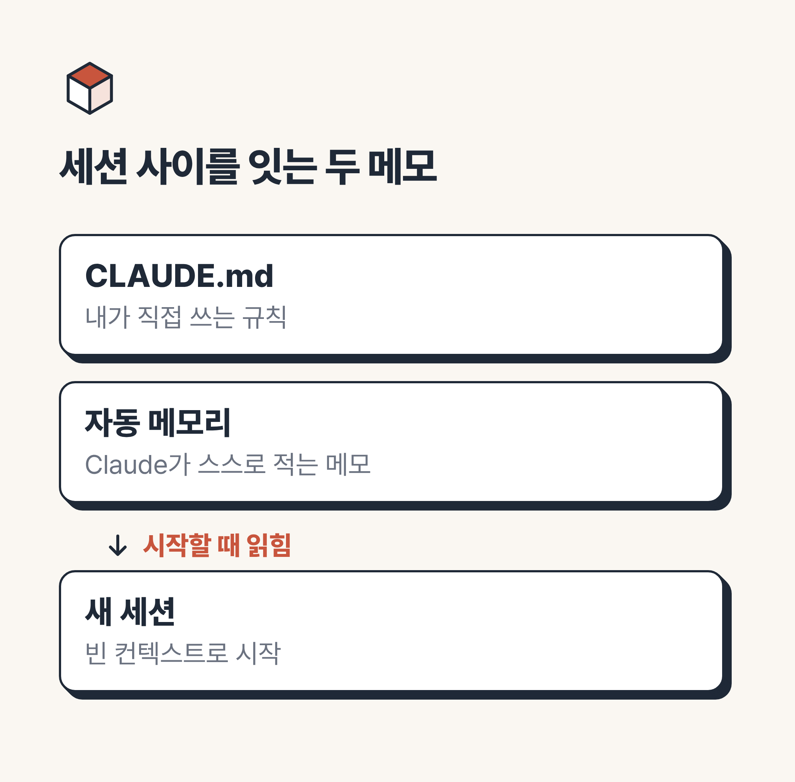
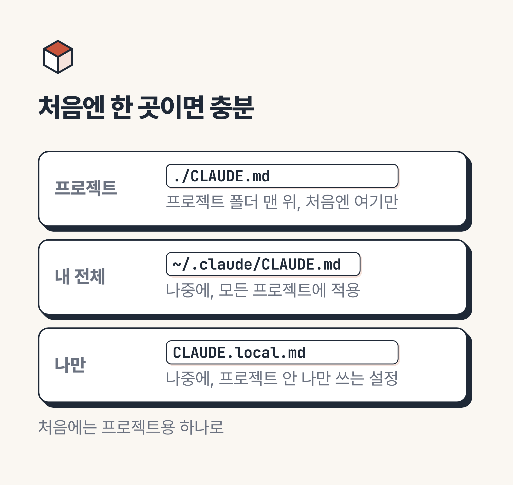
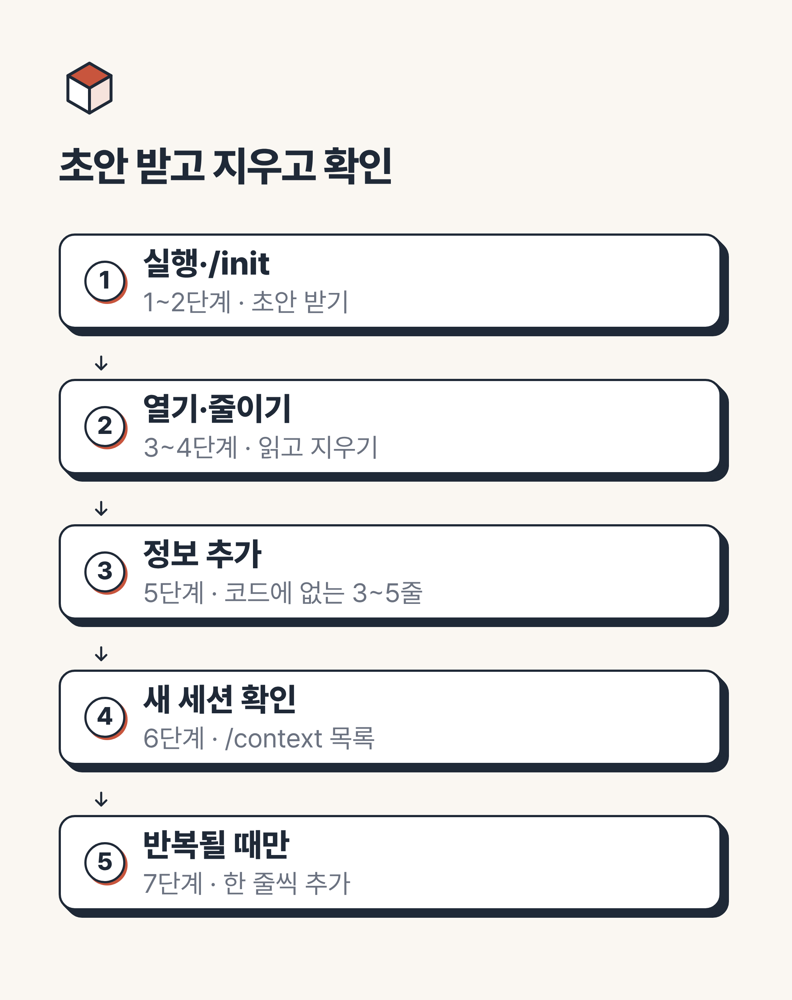
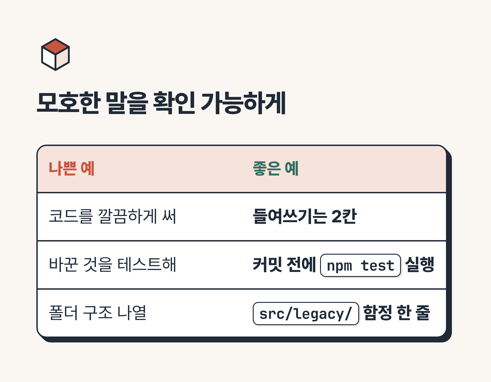
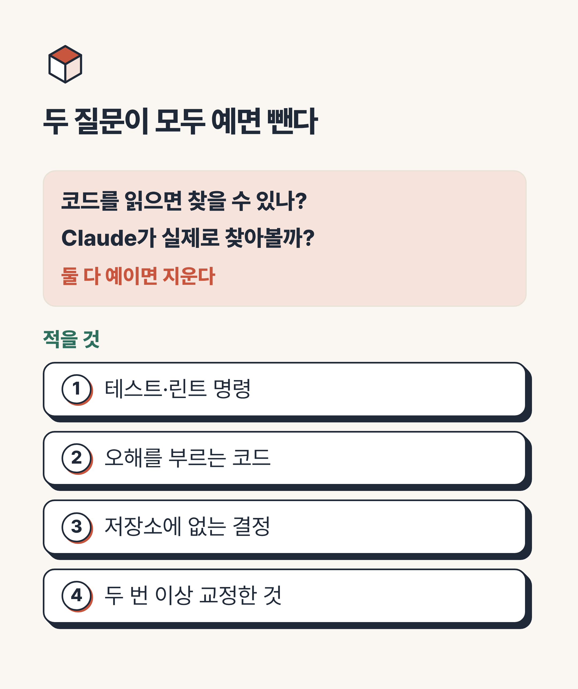
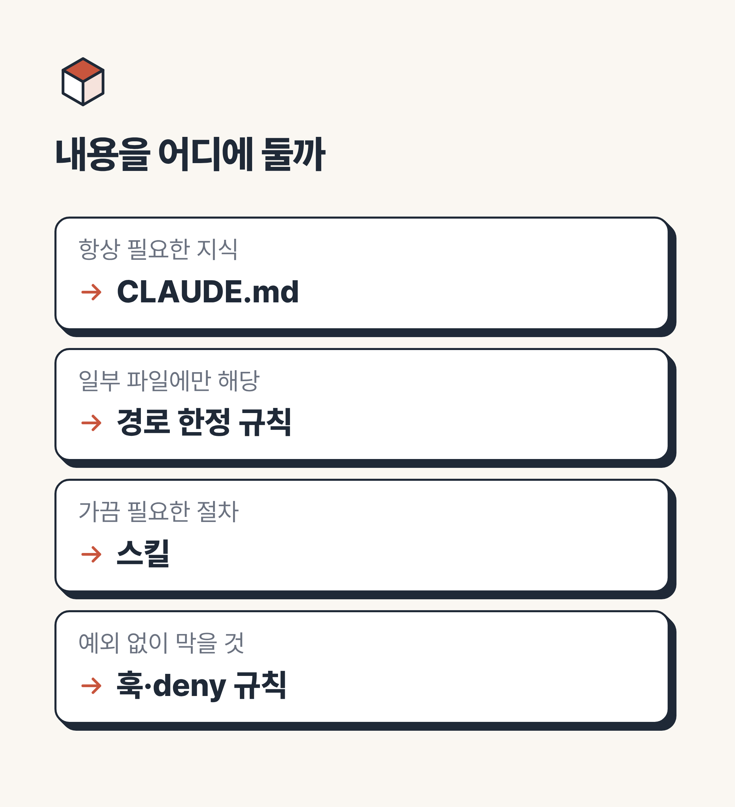

# CLAUDE.md 작성법, /init으로 직접 만드는 7단계

> 💡 **한 줄 요약:** CLAUDE.md 작성법은 어렵지 않습니다. `/init`으로 초안을 받고, 코드에 이미 있는 줄은 지우고, 코드에 없는 정보만 짧고 구체적으로 채우면 됩니다.


안녕하세요, 여러분! "어제 알려 준 걸 오늘 또 설명해야 하나?" 싶으셨다면 CLAUDE.md 작성법을 익혀 둘 때입니다.
결론부터 말씀드리면, `/init`으로 초안을 만들고 줄을 지우며 다듬는 것이 공식 문서가 안내하는 가장 쉬운 시작이에요.
이 글을 따라오시면 이유, 위치, 7단계 실습, 쓸 것과 뺄 것, 한계까지 차례로 짚으면서 여러분의 첫 파일을 직접 만들 수 있습니다.

이 글은 앞선 글 '클로드 코드 핵심 기능 5가지, 처음 쓰는 분이 먼저 익힐 것'에서 첫째로 소개한 CLAUDE.md의 실습편입니다.
개념은 앞 글에서 다뤘으니, 이번에는 손을 움직이는 데 집중해 볼게요.

---

## 🛠️ 시작하기 전에 - 무엇을 준비할까요?

* **준비물:** `claude`를 한 번이라도 실행해 본 환경, 연습용 프로젝트 폴더 하나
* **소요 시간:** 초안은 `/init`이 만들어 주니 부담이 없습니다. 시간은 다듬는 쪽에 쓰시면 돼요.
* **난이도:** 입문. 코딩 실력보다 "내가 매번 하는 말이 뭐였지?"를 떠올리는 일이 더 중요합니다.

이 글의 기능 설명과 권장 수치는 **조사일(2026-10-27)에 연 공식 문서 기준**입니다.
클로드 코드는 업데이트가 잦으니 `claude --version`으로 버전을 확인하고, 글 아래의 공식 문서와 함께 봐 주세요.

글 중간의 '직접 해 본 결과'는 2026-10-27에 Claude Code 2.1.311 버전으로, 파일 세 개짜리 연습용 할 일 목록 프로젝트에서 돌려 본 기록입니다.
질문을 한 번 보내고 답을 바로 받아 오는 실행 방식(`claude -p`)을 썼어요.
AI는 같은 질문에도 답이 조금씩 달라질 수 있으니, 여러분 화면에서는 결과가 다를 수 있습니다.

---

## 1. 쓰기 전과 후 - CLAUDE.md는 왜 필요할까?

`claude`를 켜서 끌 때까지의 한 번의 대화를 **세션**이라고 부릅니다.
새 세션은 빈 컨텍스트, 즉 Claude가 한 번에 눈앞에 두고 보는 대화와 파일의 분량이 비어 있는 상태로 시작해요.
그래서 어제 한 설명을 오늘은 전혀 모릅니다.

비유하자면 매일 첫 출근하는 신입 직원과 같습니다.
이 직원은 어제 일을 기억하지 못하니, 책상 위에 인수인계 메모를 붙여 두는 거죠.
그 메모가 **CLAUDE.md**입니다. (공식 문서의 비유가 아니라 이해를 돕기 위한 제 설명입니다.)

쓰기 전과 후는 이렇게 달라집니다. 특정인의 후기가 아니라 흔한 상황을 일반화한 표예요.

| 상황 | 쓰기 전 | 쓰기 후 |
| :-- | :-- | :-- |
| 테스트 실행 방법 | 대화를 새로 열 때마다 "테스트는 이렇게 돌려"를 입력 | 파일에 한 줄 적어 두면 새 세션부터 Claude가 그 명령을 앎 |
| 같은 교정 | 지난 세션과 같은 교정을 또 입력 | 한 번 적어 두고 읽은 채로 시작 |
| 새 팀원 합류 | 사람마다 구두로 설명 | 프로젝트 파일을 공유해 같은 맥락을 전달 |

이 차이를 직접 비교해 봤습니다.
같은 연습 프로젝트를 둘로 복사해 한쪽에만 뒤에서 보여 드릴 예시 A 같은 CLAUDE.md를 두고, 똑같이 물었어요.
"이 페이지를 고친 뒤에 화면이 잘 열리는지 확인하려면 어떻게 해야 해? 방법만 알려 줘."라는 질문입니다.

| | CLAUDE.md 없음 | CLAUDE.md 있음 |
| :-- | :-- | :-- |
| 답의 모양 | 확인 방법 5가지를 나열 | `python3 -m http.server 8000` 하나로 4단계 안내 |
| 내용 | 파일 직접 열기, 개발자 도구, 화면 크기별 확인 등 일반론 (프로젝트와 상관없는 내용도 섞임) | 파일에 적어 둔 미리보기 방법 그대로 |
| 첫 문장 | "확인하는 방법은 다음과 같습니다" | 실행할 명령부터 (결론 먼저) |
| 마지막 문장 | "원하시면 제가 직접 서버를 띄워 드릴 수도 있습니다" | "이 프로젝트 규칙상 코드를 바꾼 뒤 같은 방법으로 확인하고 알려 드릴게요" |

파일에 한 줄 적어 둔 것만으로 답이 '일반적인 정답 목록'에서 '이 프로젝트의 정답 하나'로 좁혀졌어요.
다만 한 번 돌려 본 결과이고, 같은 질문도 문장은 매번 조금씩 달라집니다.

다만 이 파일은 지시서가 아니라 **참고 자료**에 가깝습니다.
공식 문서에 따르면 내용은 시스템 프롬프트가 아니라 그 뒤의 사용자 메시지로 전달되기 때문에, 엄격한 준수가 보장되지는 않아요.

그렇다면 언제 한 줄을 적으면 될까요? 공식 문서가 드는 기준은 네 가지입니다.

* Claude가 같은 실수를 두 번째로 할 때
* 코드 리뷰에서 "이 코드베이스에선 알았어야 할 것"이 지적될 때
* 지난 세션과 똑같은 교정을 또 입력하게 될 때
* 새 팀원도 같은 맥락이 필요할 때



---

## 2. 어디에 두나요? - 개인용·프로젝트용·하위 폴더

파일을 둘 수 있는 곳은 여러 군데지만, 입문 단계에서는 세 가지만 기억하셔도 충분합니다.

| 종류 | 위치 | 적용 범위 | 이럴 때 |
| :-- | :-- | :-- | :-- |
| 개인용 | `~/.claude/CLAUDE.md` | 나만, 모든 프로젝트 | 답변 방식처럼 어디서든 바라는 개인 선호 |
| 프로젝트용 | `./CLAUDE.md` 또는 `./.claude/CLAUDE.md` | 버전 관리로 팀원과 공유 | 실행 명령, 팀의 규칙 |
| 하위 폴더용 | 하위 폴더 안의 `CLAUDE.md` | Claude가 그 폴더의 파일을 읽거나 쓰거나 고칠 때 한 번 로드 | 폴더마다 규칙이 다른 큰 프로젝트 |

`./`는 프로젝트 폴더 맨 위를 뜻하고, `~`는 내 컴퓨터의 홈 폴더입니다.
프로젝트 안에서 나만 쓰는 설정까지 합치면 네 곳이 되는데, 그건 `CLAUDE.local.md`에 두고 `.gitignore`(git이 추적하지 않을 파일을 적는 목록)에 추가하면 공유되지 않아요.

여기서 많은 분들이 헷갈려 하시는 게 "파일이 여러 개면 어느 것이 이기나요?"라는 질문입니다.
공식 문서의 설명은 덮어쓰기가 아니라 **이어 붙이기**예요.

작업 폴더와 그 위쪽 폴더의 파일을 시작할 때 모두 읽어 이어 붙이고, 작업 폴더에 가까운 지침이 나중에 읽힙니다.
서로 충돌하면 어느 쪽을 따를지 보장되지 않으니, 같은 주제를 두 곳에 다르게 적지 않는 편이 안전합니다.

처음에는 **프로젝트용 하나**로 시작하시길 권해요.



---

## 3. 직접 만들어 보기 - /init으로 시작하는 7단계

이제 본격적으로 손을 움직일 차례입니다.
처음부터 빈 화면에 쓰는 게 아니라, 초안을 받아 다듬는 방식이라 훨씬 수월해요.
아래 순서대로 차근차근 따라와 주세요.

1. **프로젝트 폴더에서 `claude` 실행:** 연습용 폴더로 이동해 실행합니다. (파일이 만들어질 위치가 이 폴더이니 폴더를 잘못 고르지 않았는지 먼저 확인하세요.)
2. **`/init` 입력:** Claude가 코드를 분석해 빌드 명령, 테스트 방법, 발견한 관례를 담은 초안을 만듭니다. (이미 CLAUDE.md가 있으면 덮어쓰지 않고 개선안을 내놓아요. 환경 변수, 곧 미리 켜 두는 설정값인 `CLAUDE_CODE_NEW_INIT=1`을 켜면 스킬·훅까지 묻는 대화형 흐름이 되는데, 입문 단계에서는 없어도 충분합니다.)
3. **`/memory`로 초안 열어 읽기:** 메모리 파일 목록이 나오고, 고르면 편집기로 열립니다. (아직 없는 파일을 고르면 먼저 만들어 줍니다.)
4. **줄이기:** Claude가 코드만 봐도 알 만한 줄(폴더 설명 등)은 지우고, 모호한 줄은 구체적으로 바꿉니다. (이 단계가 작성의 핵심입니다.)
5. **코드에 없는 정보 3~5줄 추가:** 실행할 때의 함정, 팀이 정한 결정처럼 코드에서 읽어 낼 수 없는 것을 적습니다. (줄 수는 제가 입문자용으로 제안하는 감각이지 공식 수치가 아닙니다.)
6. **새 세션에서 `/context` 확인:** `claude`를 껐다 켠 새 세션에서 입력하면, 지금 어떤 파일이 컨텍스트에 올라와 있는지 볼 수 있어요. **Memory files** 목록에 CLAUDE.md가 보이면 성공입니다. (하위 폴더 파일은 시작 때 로드되지 않아 이 목록에 없는 게 정상입니다.)
7. **반복될 때만 한 줄씩 추가:** 같은 실수가 되풀이될 때만 늘려 갑니다. (앞서 본 네 가지 기준이 판단선이에요.)

초안이 몇 줄로, 어떤 항목으로 나오는지는 프로젝트와 환경마다 다릅니다.
그래서 2~4단계에서 여러분의 눈으로 직접 읽어 보는 과정이 꼭 필요해요.

연습 프로젝트(아직 CLAUDE.md가 없는 상태)에서 `/init`을 실행해 보니, 15초 남짓 만에 17줄짜리 파일이 만들어졌습니다.
`Overview`, `Structure`, `Conventions` 세 구역이었고, 담긴 내용은 이렇습니다.

* 빌드·린트·테스트 도구가 없으니 `index.html`을 브라우저로 열어 확인한다는 안내
* `index.html`과 `app.js`가 같은 id(`task`, `add`, `list`)를 쓰니 한쪽을 바꾸면 양쪽을 고치라는 경고
* 파일별 역할 설명, 그리고 `old/legacy.js`는 쓰지 않는 파일이니 건드리지 말라는 메모

눈에 띈 점은 세 가지였어요.

* **언어:** 화면 문구는 한국어인데 초안은 영어로 쓰여 있었습니다. 한국어로 바꿀지 정하는 것도 다듬기의 일부예요.
* **지울 후보:** 파일별 역할 설명은 코드를 열면 바로 아는 내용이라 4단계에서 지울 후보였습니다.
* **남길 후보:** id 경고와 `old/` 메모는 코드만 봐서는 놓치기 쉬운 함정이라 남길 후보였고요.

이 기준대로 줄이고 한국어로 바꾸니 7줄이 되었습니다.

```markdown
# 프로젝트
- 연습용 할 일 목록 웹페이지 (HTML, CSS, JavaScript만 사용)
- 확인: index.html을 브라우저로 열기 (빌드·테스트 도구 없음)

# 주의
- index.html의 id(`task`, `add`, `list`)는 app.js와 짝이라, 바꾸면 두 파일을 함께 고친다
- `old/`는 쓰지 않는 예전 연습 코드라 건드리지 않는다
```

6단계의 확인 화면도 환경마다 조금씩 다르게 보일 수 있습니다.

새 세션에서 `/context`를 실행해 보니 아래처럼 Memory files 항목에 방금 만든 파일이 올라와 있었어요. (필요한 부분만 옮겼습니다.)

```text
Memory files   369 tokens   0.0%

Type      Path                          Tokens
Project   .../todo-practice/CLAUDE.md   369
```

17줄짜리 초안이 차지한 분량은 369토큰이었고, 전체의 소수점 이하(0.0%)였습니다.
(토큰은 AI가 글을 읽을 때 쓰는 단위로, 단어를 잘게 나눈 조각 정도로 보시면 됩니다.)
목록에 파일이 보이면 읽힌다는 뜻이니, 가장 먼저 확인할 곳이 바로 여기예요.

> 📌 **전문가 Tip:** 공식 모범 사례는 `/init`이 시작 버전을 만들어 줄 뿐이고, 거기서부터의 일은 주로 줄을 지우는 것이라고 설명합니다. 초안이 허전해 보여도 채우려 하기보다 덜어 내는 쪽에 시간을 써 보세요.



### 다듬은 결과는 이런 모양입니다 - 예시 A

아래는 할 일 목록 웹페이지 연습 프로젝트를 가정해서 입문자용으로 만든 **가상의 예시**입니다.
공식 문서의 예시가 아니라 설명을 위해 만든 예시예요. 명령과 파일 이름은 여러분의 프로젝트에 맞게 바꿔 쓰셔야 합니다.

```markdown
# 프로젝트
- 개인 연습용 할 일 목록 웹페이지 (HTML, CSS, JavaScript만 사용)

# 실행·확인
- 미리보기: `python3 -m http.server 8000` 실행 후 브라우저에서 localhost:8000 열기
- 코드를 바꾼 뒤에는 위 방법으로 화면이 열리는지 확인했다고 알려 줘

# 규칙
- 설명과 답변은 한국어로, 결론부터 말해 줘
- 새 라이브러리는 설치하기 전에 먼저 물어봐
- 들여쓰기는 2칸

# 주의
- `old/` 폴더는 예전 연습 코드다. 새 코드에서 그 방식을 따라 하지 않는다
```

파일은 **마크다운**, 곧 `#` 제목과 `-` 목록 같은 간단한 기호로 서식을 주는 일반 글 형식으로 씁니다.
공식 문서도 빽빽한 문단보다 제목과 글머리표로 묶어 두는 쪽이 따르기 쉽다고 안내해요.

짧은 파일인데도 실행 방법, 답변 방식, 함정이 모두 들어 있죠?
폴더 구조를 설명하는 줄이 하나도 없다는 점도 눈여겨보세요.

### 규칙이 늘어날 때는 - 예시 B

규칙이 많아지면 주제별로 쪼갤 수도 있습니다.
`.claude/rules/` 폴더에 `css.md` 같은 파일을 두는 방식이고, 이것도 제가 만든 가상의 예시입니다.

```markdown
---
paths:
  - "**/*.css"
---
- 색상 값은 `:root`의 CSS 변수만 사용한다
```

맨 위 `---` 사이의 설정 부분을 **프런트매터**라고 하는데, 이 규칙 파일이 읽는 설정은 `paths` 하나뿐입니다.
`**/*.css`는 **glob**(글롭)이라 부르는 표기로, `*` 기호를 써서 CSS 파일 전체를 한꺼번에 가리켜요.

`paths`가 없는 규칙 파일은 시작할 때 함께 로드되고, 있으면 해당 파일을 다룰 때만 로드됩니다.
특정 파일에만 해당하는 규칙을 따로 빼 두면 평소 읽는 분량이 줄어드니 유용하죠.

---

## 4. 무엇을 쓰고 무엇은 뺄까요? - 좋은 예와 나쁜 예

CLAUDE.md 작성법에서 가장 자주 막히는 곳이 바로 이 부분입니다.
공식 모범 사례가 정리한 **적을 것**은 이렇습니다.

* 작업이 끝났는지 확인하는 정확한 테스트·타입 검사·린트 명령, 테스트 하나만 돌리는 법
* 코드가 오해를 부르는 곳 (곳곳에 있지만 새 코드는 따라 하면 안 되는 옛 패턴 등)
* 코드 저장소에 남지 않는 결정 (배포 방식, 에러 처리 도우미 등)
* 두 번 이상 교정해 준 것

**뺄 것**을 가려내는 질문은 딱 두 개입니다.
"코드를 읽으면 찾을 수 있나?" 그리고 "Claude가 실제로 찾아볼까?"예요. 둘 다 "예"라면 지우셔도 됩니다.

디렉터리 구조나 아키텍처(구조 설계) 설명을 길게 쓰라는 옛 조언은 현재 공식 모범 사례에서 불필요하다고 표시되어 있어요.
막연한 말보다 확인 가능한 말이 좋다는 점은 공식 문서의 대비 예에서도 드러납니다.

| 나쁜 예 | 좋은 예 | 이유 |
| :-- | :-- | :-- |
| 코드를 깔끔하게 써 | 들여쓰기는 2칸 | 기준이 눈에 보여야 확인할 수 있음 |
| 바꾼 것을 테스트해 | 커밋 전에 `npm test` 실행 | 어떤 명령을 쓰는지가 담김 |
| 프로젝트 구조는 이렇다 (폴더 수십 개 나열) | `src/legacy/`는 쓰이고 있지만 새 코드는 그 방식을 따라 하지 않는다 | 읽으면 알 수 있는 것은 빼고 함정만 남김 |
| 절대 실수하지 마!!! IMPORTANT | 통합 테스트는 `DATABASE_URL` 설정이 필요하다 | 강조보다 구체적인 사실이 도움이 됨 |

표의 문구는 공식 문서의 예시를 한국어로 풀어 쓰거나 합친 것이라, 원문과 글자까지 똑같지는 않아요.



모호한 규칙과 구체적인 규칙의 차이도 직접 확인해 봤습니다.
연습 프로젝트에 "새로고침해도 할 일 목록이 남도록 저장 기능을 추가해 줘."라고 요청하고, CLAUDE.md의 규칙 한 줄만 다르게 뒀어요.

| 규칙 | 결과 (`app.js`의 저장 키 이름) |
| :-- | :-- |
| "데이터는 적절하게 저장해" | `todos` |
| "할 일 목록은 localStorage의 `todo-items` 키에 JSON 배열로 저장한다" | `todo-items` (답변에도 "CLAUDE.md 규칙을 따랐다"고 적음) |

모호한 규칙이 무시된 건 아니에요.
기준이 없으니 Claude가 알아서 이름을 정했을 뿐이고, 구체적으로 적자 정해 둔 이름 그대로 쓰였습니다.
키 이름처럼 코드만 봐서는 알 수 없는 약속일수록 한 줄로 적어 둘 가치가 있어요.

대문자 강조도 한마디 덧붙일게요.
공식 모범 사례에 따르면 요즘 모델에는 `IMPORTANT` 같은 강조가 필요 없고, 오히려 규칙을 과하게 적용하게 만들 수 있다고 합니다.

그리고 한 가지 더 있습니다.
**비밀번호와 API 키는 이 파일에 적지 않으시길 권합니다.**
공식 문서에 이를 직접 금지하는 문구가 있는 것은 아니지만, 프로젝트 CLAUDE.md는 팀과 공유되는 파일이고 내용이 Claude에게도 전달되기 때문에 안전상 그렇게 하는 편이 좋아요.
개인용 값은 `.gitignore`한 `CLAUDE.local.md`에 두는 것이 공식 안내입니다.



---

## 5. 자주 하는 실수와 한계 - 왜 안 지켜지는 걸까요?

쓰다 보면 "분명히 적었는데 왜 안 따르죠?" 하는 순간이 옵니다.
먼저 장단점을 한눈에 보겠습니다.

| 항목 | 장점 👍 | 단점 👎 |
| :-- | :-- | :-- |
| 반복 설명 | 같은 설명을 매번 하지 않아도 됨 | 강제가 아니라 맥락이라 어길 수 있음 |
| 공유 | 프로젝트 파일로 팀과 같은 맥락 공유 | 길수록 지침을 덜 따를 수 있음 |
| 시작 난도 | 파일 하나로 시작 가능 | 규칙끼리 모순되면 Claude가 임의로 고를 수 있음 |
| 관리 | 필요할 때 한 줄씩 추가 | 옛 지침이 남지 않게 주기적 점검이 필요함 |

이 표에서 비롯되는 실수와 대처법을 순서대로 보겠습니다.

**1) 강제 규칙으로 믿는 실수**

CLAUDE.md는 Claude가 읽고 판단하는 지침입니다.
반면 **훅**(특정 시점에 자동으로 실행되는 명령)과 **deny 규칙**(특정 파일이나 명령을 아예 못 쓰게 막는 권한 설정)은 Claude Code가 항상 실행하는 방식이에요.

공식 모범 사례의 예를 빌리면, `.env` 파일을 읽지 못하게 하는 일은 CLAUDE.md가 아니라 deny 규칙이 맞습니다.
반대로 "가능하면 이름 있는 내보내기를 선호"처럼 예외가 많은 선호는 CLAUDE.md에 남기는 게 맞고요.

**2) 너무 길게 쓰는 실수**

조사일 기준 공식 문서는 파일당 200줄 미만을 목표로 짧게 유지하길 권장합니다.
줄마다 매 작업에서 Claude의 주의를 조금씩 쓰게 되기 때문이에요.

`@경로`로 다른 파일을 불러와 정리할 수는 있지만, 가져온 파일도 함께 로드되어 분량이 줄지는 않습니다.
여러 단계의 절차라면 스킬로, 일부 파일에만 해당하는 내용이라면 앞서 본 경로 한정 규칙으로 옮기는 쪽이 좋아요.

줄이는 효과도 숫자로 확인해 봤어요.
앞서 `/init`이 만든 17줄 초안은 369토큰이었는데, 코드에서 알 수 있는 줄을 지운 7줄 버전은 `/context`에서 180토큰으로 나왔습니다.
같은 정보를 담고도 분량이 절반 정도로 줄어든 셈이고, 파일이 커질수록 이 차이도 커집니다.

**3) 모순을 방치하는 실수**

사용자 파일, 프로젝트 파일, 하위 폴더 파일, 규칙 파일이 서로 다른 말을 하면 Claude가 아무거나 고를 수 있습니다.
가끔 한 번씩 훑어보며 겹치거나 엇갈리는 줄이 없는지 점검해 주세요.
`/doctor`로 설정과 CLAUDE.md의 문제를 진단받을 수도 있습니다.

모순을 일부러 만들어서도 시험해 봤어요.
`CLAUDE.md`에는 "답변은 한 줄로만 짧게 해", `.claude/rules/answer.md`에는 "답변은 항목별로 나눠서 자세하게 설명해"라고 적고 "app.js가 하는 일을 설명해 줘."를 세 번 물었습니다.

* 1회: 항목별로 나누되 각 항목은 짧게 쓰는 절충안으로 답하고, 어느 지침을 따를지 알려 달라고 되물었어요.
* 2회, 3회: 둘 다 `CLAUDE.md`의 한 줄 답변을 따랐다고 밝혔습니다.

공식 문서 설명처럼 어느 쪽을 따를지 매번 달랐어요.
세 번 모두 충돌 사실을 스스로 알려 준 건 다행이지만, 항상 그럴 거라고 믿기는 어렵습니다.
이런 알림이 보이면 한쪽을 지우거나 하나로 합치는 게 가장 확실한 해결책이에요.

**4) 옛 조언을 그대로 따르는 실수**

폴더 구조를 길게 적는 방식뿐 아니라, 요즘 모델에 필요 없는 큰 소리 강조도 마찬가지입니다.
블로그나 영상에 나온 방법이 지금도 맞는지는 공식 문서로 확인하는 습관이 좋아요.

내용을 어디에 두면 좋을지는 아래처럼 정리됩니다.

| 이런 내용이라면 | 알맞은 곳 |
| :-- | :-- |
| 항상 필요한 지식, 예외가 있는 선호 | CLAUDE.md |
| 코드베이스 일부 파일에만 해당 | 경로 한정 규칙 |
| 가끔 필요한 여러 단계 절차 | 스킬 |
| 예외 없이 막아야 하는 것 | 훅, deny 규칙 |



> 📌 **전문가 Tip:** 이 글의 200줄 같은 수치는 조사일(2026-10-27) 기준 공식 문서의 권장값입니다. 버전이 올라가면 달라질 수 있으니, `claude --version`으로 버전을 확인하고 아래 공식 문서에서 최신 내용을 함께 봐 주세요.

---

## 자주 묻는 질문 - 이런 건 어떨까요?

**Q. CLAUDE.md를 꼭 써야 하나요?**
안 써도 클로드 코드는 동작합니다.
같은 설명을 반복하거나 같은 교정을 두 번 하게 될 때, 그때 한 줄 적어 두셔도 늦지 않아요.

**Q. 자동 메모리와는 뭐가 다른가요?**
CLAUDE.md는 내가 직접 쓰는 규칙이고, 자동 메모리는 Claude가 사용자의 교정과 선호를 보고 스스로 적어 두는 메모입니다.

| | CLAUDE.md | 자동 메모리 |
| :-- | :-- | :-- |
| 쓰는 사람 | 나 | Claude |
| 내용 | 지침과 규칙 | 배운 것과 패턴 |
| 공유 | 프로젝트 파일은 팀과 공유 가능 | 내 컴퓨터에만 저장 |

자동 메모리는 로컬 세션에서 기본으로 켜져 있고, `/memory`에서 켜고 끌 수 있어요.
저장된 메모도 평문 마크다운이라 열어서 고치거나 지울 수 있습니다.

자동 메모리도 연습 프로젝트에서 시험해 봤는데, 문서 설명과 똑같이 보이지는 않았어요.
"앞으로 패키지는 npm 말고 항상 pnpm을 써 줘. 기억해 둬."라고 하자 자동 메모리 폴더가 아니라 프로젝트의 `CLAUDE.md`에 규칙 한 줄이 적혔습니다.
"나는 이모지가 싫어"라고만 말했을 때는 그 답변에서만 반영됐고, 새로 생긴 파일이나 메모리 폴더는 없었어요.

공식 문서는 기억해 달라고 하면 자동 메모리에 저장된다고 설명합니다.
제 시험은 클라우드 환경에서 대화 없이 한 번에 실행하는 방식이었고, 문서에도 일부 실행 환경에서는 자동 메모리가 기본으로 꺼진다는 설명이 있어요.
정확한 원인은 확인하지 못했습니다.
그러니 여러분은 평소 쓰는 대화 화면에서 `/memory`를 열어 자동 메모리 폴더에 무엇이 쌓였는지 직접 확인해 보세요.

**Q. 서브에이전트도 CLAUDE.md를 읽나요?**
일반 서브에이전트는 메인 대화가 로드한 CLAUDE.md를 처음부터 받습니다.
다만 내장 Explore와 Plan은 빠르고 가볍게 움직이려고 건너뜁니다.
메인 대화의 자동 메모리도 서브에이전트에는 로드되지 않으니, 꼭 전달해야 하는 규칙은 일을 맡기는 메시지에 다시 적어 주세요.

**Q. 만들었는데 적용이 안 되는 것 같아요.**
새 세션에서 `/context`를 열어 Memory files 목록을 먼저 확인하세요.
위치가 프로젝트 폴더 맨 위(또는 `.claude/` 안)가 맞는지도 점검하시고요. 하위 폴더 파일은 그 폴더의 파일을 다룰 때 로드되니 처음 목록에 없는 게 정상입니다.

**Q. 이미 AGENTS.md가 있는데요?**
최신 버전 기준으로, AGENTS.md만 있는 저장소는 그 파일을 그대로 읽습니다.
CLAUDE.md도 함께 있으면 CLAUDE.md만 읽으니, 둘을 같이 쓰려면 CLAUDE.md 안에 `@AGENTS.md` 한 줄을 적어 주세요.

**Q. `#`을 입력해서 메모리를 추가한다던데요?**
예전 자료에 나오는 방법이고 지금 공식 문서에는 없습니다.
현재 공식 안내는 Claude에게 "이걸 CLAUDE.md에 추가해 줘"라고 말하거나 `/memory`로 직접 편집하는 방법이에요.
공식 문서는 "기억해 줘"라고 부탁한 내용이 자동 메모리에 저장된다고 설명하니, CLAUDE.md에 넣고 싶다면 "CLAUDE.md에 추가해 줘"라고 분명히 말씀해 주세요.

### 공식 문서에서 더 확인하고 싶다면

* Claude가 프로젝트를 기억하는 방법(CLAUDE.md와 메모리): https://code.claude.com/docs/en/memory
* 클로드 코드 모범 사례: https://code.claude.com/docs/en/best-practices

---

## 마무리하며

오늘은 CLAUDE.md 작성법을 왜 필요한지, 어디에 두는지, `/init`으로 시작하는 7단계, 쓸 것과 뺄 것, 흔한 실수 순서로 살펴보았습니다.
정리하면 "`/init`으로 시작하고, 지우는 데 시간을 쓰고, 짧고 구체적으로 적는다"는 세 줄이에요.


앞선 글의 다섯 기능 중 첫째를 이제 직접 손으로 해 보신 셈입니다.
처음부터 완벽한 파일을 만들 필요는 없어요. 한 줄씩 쌓이다 보면 어느새 여러분의 프로젝트에 딱 맞는 메모가 되어 있을 겁니다.
이 글이 그 첫 줄을 쓰는 데 도움이 되었기를 바랍니다.

여러분의 첫 CLAUDE.md에는 어떤 한 줄이 들어갈 것 같으신가요?
따라 하다 막힌 부분이나 궁금한 점은 댓글로 남겨주세요. 함께 풀어봐요. 감사합니다!

#CLAUDEmd작성법 #클로드코드 #ClaudeCode #클로드코드입문 #CLAUDEmd #init명령어 #클로드코드메모리 #클로드코드초기설정 #AI코딩도구
